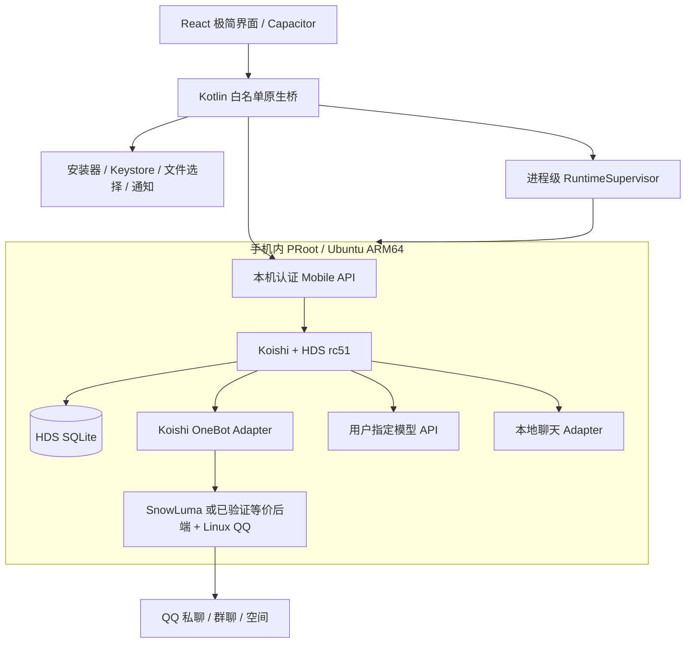

# 拟实施架构与接口边界

本文全部为设计约定，除明确引用的原有模块外，新 API 与目录尚不存在。

## 1. 架构决策

| 方案 | 保真度/成本 | 本计划选择 |
|---|---|---|
| Kotlin/Dart 全面重写 HDS | 需重新实现大量剧情、调度和存储语义；回归风险高 | 不作为首版路线 |
| 只包装远程 HDS 网页 | 小体积，但依赖远程主机 | 不满足用户独立运行要求 |
| 在 WebView 中直接运行 HDS | 缺 Node、Koishi 数据库、QQ 用户空间依赖 | 不可直接采用 |
| 安卓本地 PRoot + 原 HDS | 体积/耗电较高，最容易保持业务原貌 | 优先路线；先过真机验证门槛 |

PRoot 提供 Linux 用户空间，不是真 Docker 容器；不会自动提供主机 Root 或额外 Android 权限。

## 2. 组件关系



浏览器中的 UI 只加载本地打包资源。业务请求通过 Kotlin 白名单方法传递到 loopback API；凭据只在原生与运行时侧使用。QQ 登录网页/必要 noVNC 与高级 Koishi Console 置于独立受限 WebView，不向它们暴露通用原生桥。

## 3. 建议工程布局

```text
apps/mobile-ui/                    React/TypeScript 界面
android/                           Capacitor + Kotlin
packages/contracts/                API schema、能力枚举、事件结构
packages/card-format/              角色卡与世界书纯解析/导出
packages/card-hds-mapping/          卡到 HDS 的映射和兼容报告
packages/mobile-api/               Koishi 插件：管理 façade
packages/adapter-local/            本地对话端点，不冒充 QQ 账号
packages/channel-contracts/        QQ 后端能力、错误与健康状态
runtime/profile/                   固定版本 Koishi 宿主与配置模板
runtime/build/                     Linux ARM64 构建/打包入口
runtime/launchers/                 固定启动入口及进程清理
upstream/hds-interlude/            固定提交源码 + 小范围补丁
patches/hds/                       每个补丁的理由与对应回归用例
fixtures/cards/                    可公开的合成卡样本
fixtures/hds/                      固定时钟/模型/渠道响应
docs/evidence/                     基线、真机、测试和性能报告
```

可选 Git submodule 或 vendor 源码，但必须可离线定位固定版本及修改。不要将上游编译产物与修改后的源码脱节。单一根 lockfile/明确的运行时 lockfile；跨工作区版本关系由 CI 检查。

## 4. 原生运行管理

RuntimeSupervisor 属于应用进程，不属于某个 Activity/WebView。安装、运行、登录、模型配置四个状态机分离：

- 安装：absent → preparing → verifying → extracting → ready；失败保存具体阶段和可恢复信息。
- 运行：stopped → starting → healthy/degraded → stopping；崩溃退避与有限重试。
- QQ：notConfigured → waitingLogin → online → reconnecting/expired/blocked。
- 模型：missing → configured → testing → available/unavailable；不能用“有 Key”代表连接成功。

启动顺序：检查 ABI/空间/资源清单 → 校验运行环境 → 必要显示/登录辅助进程 → QQ 后端 → Koishi/HDS → Mobile API 健康检查。UI 可先打开，显示各阶段；QQ 不在线时仍能编辑角色与查看历史。

停止按依赖逆序：关闭新任务入口 → HDS 暂停/中止并落盘 → 断开渠道 → 终止已登记子进程 → 关闭辅助显示进程。只管理本应用启动的进程组；禁止用全局 `pkill node/qq` 清理用户其他环境。

所有进程通过固定入口和参数数组启动；角色名、卡内容、URL 不拼到 shell。禁止提供 UI/模型可调用的任意宿主命令接口。

安装器必须校验来源、精确长度、SHA-256、版本、ABI；解包限制大小/文件数并防路径越界，使用 staging 和原子切换。rootfs 与用户数据分离，重装环境不能删角色和故事。预先编译依赖，不能让普通用户在手机上运行 npm 原生编译。

QQ 和 SnowLuma 的版本组合须绑定验证；登录态目录持久化，升级前检查兼容，不能悄悄跨大版本替换。Linux QQ 获取/分发方案由 T01 决定；APK 内置基础运行时与单独取得 QQ 组件均可作为工程实现，但最后必须自动化、可恢复、无命令行依赖。

## 5. Koishi 与 HDS 宿主

建立真实 Koishi Context，加载 HTTP、SQLite、OneBot、HDS、mobile-api 和 local adapter；浏览/截图能力按功能需求加载 puppeteer 及可用 Chromium。精确版本由 T01 验证后锁定，不把 HDS peerDependency 的范围直接当发布锁。

默认保持 `HDSI_DESKTOP_BRIDGE` 关闭，QQ 通过 Koishi adapter 的真实 Bot/Session 接入。mobile-api 获得 `ctx.interlude`，对缺少公共方法的管理行为增加小范围、可测试的 typed façade；禁止借 `as any` 大规模调用 private 方法，禁止 UI 直接写 HDS 表。

既有时间线投影方法可复用，但范围、过滤和分页依然由宿主验证。前端不能将完整剧本中的所有台词直接显示成“已发送消息”；会话列表只展示真实收发与已确认投递，剧情另有视图。

本地聊天新增 `platform=mobile-local` 的真实 adapter；扩展 HDS 端点类型以表达 local，不伪造 OneBot selfId。默认与 QQ 参与者身份分开；只有明确绑定“这是同一个人”后才共享关系状态。应用账号对应管理权限，不自动等价于任意 QQ 用户。

角色库与运行档案分离：每个运行档案有独立 dataDir、Koishi 配置与 HDS SQLite，内部保持一个 Canonical Story。首版只运行一个档案；切换前暂停并落盘旧档案，再加载新档案。角色卡升级不自动重写进行中的 Canon 或历史。

## 6. 手机 API 合约

对 UI 提供 typed RPC，Kotlin 仅映射允许的 method 到本机 HTTP API。固定 transport schema，错误可翻译，重试语义明确。下面是拟定结构，T04 落地为 JSON Schema 或等价校验：

```ts
type MobileRequest = {
  requestId: string;
  method: string;
  profileId?: string;
  expectedRevision?: number;
  payload: unknown;
};
type MobileResponse = {
  requestId: string;
  ok: boolean;
  revision?: number;
  data?: unknown;
  error?: { code: string; message: string; retryable: boolean };
};
type MobileEvent = {
  epoch: string;
  seq: number;
  type: string;
  profileId?: string;
  occurredAt: string;
  payload: unknown;
};
```

| 方法族 | 具体操作 | 约束 |
|---|---|---|
| runtime | status/start/stop/restart/diagnostics | 固定入口；互斥；无任意 shell |
| capabilities | get | 明示协议版本、后端及逐动作验证状态 |
| profiles | list/create/select/archive | 切换事务；不销毁其他档案 |
| cards | inspect/commit/list/update/export | 原始卡哈希、预览 token、幂等提交 |
| story | snapshot/timeline/settings/pause/resume | 分页；使用 HDS 服务层；版本冲突返回 409 |
| memory | list/inspect/add/apply/compact | 对应 HDS 管理语义；来源可追溯 |
| messages | sendLocal/history | requestId 幂等；本地参与者身份固定 |
| channels | list/configure/login/status | Key/cookie 不回显；分别报告账号和动作能力 |
| qzone | feed/actionStatus/submitAction | 与 HDS 共用限流、审计及未知结果状态 |
| models | list/save/test/assign | 返回 credentialPresent，不返回保存的密钥 |
| backup | prepare/export/inspect/restore | 停写/快照一致性；恢复前预览 |

非敏感方法请求体上限建议 1MiB；图片、卡包和备份走流式临时文件 ID。临时 ID 必须绑定应用会话与实际文件，不能传任意绝对路径读取。

事件至少包括 runtime.status、channel.status、story.changed、message.received、delivery.changed、task.progress。有限 replay 窗口；epoch 改变或游标过期时客户端重新取快照。WebView 重建不重复发消息；真实业务幂等记录必须落盘，不能只存在 JS 内存。

## 7. 凭据与本机网络

API Key 由 Android Keystore 加密保存，UI 保存成功后清除输入，日志只记录 credentialPresent。经原生进程启动握手/受保护通道送至 HDS 内存；不要写入分享卡、koishi.yml 导出或 localStorage。若上游某组件要求落盘凭据，限于 app 私有目录并在文档中明示，不能宣称全部凭据永不落盘。

所有控制端口、OneBot、QQ WebUI 和 VNC 绑定 loopback，并分别认证。每次启动的 API token 随机生成且不放 URL；仅 loopback 不是认证措施。校验 Host/Origin，阻止其他网页调用控制 API。UI 网页不拥有通用 HTTP/Shell 代理能力。

第三方内容只作为聊天/卡文本渲染。Markdown 禁用原始脚本与危险 HTML；外部链接交系统浏览器。普通卡片导入不可自动修改模型 endpoint、Key、代理或管理权限。

首版不带 Shizuku/无障碍/读取全部应用/读取短信通讯录等权限。文件通过 SAF；只有用户录音时请求麦克风。通知/后台运行按当前 Android 规则实现。

## 8. QQ 与空间适配

后端能力按 `privateText/groupText/imageIn/imageOut/audioIn/qzoneRead/qzonePost/qzoneComment/qzoneLike` 分开表示，状态包括 verified、untested、unsupported，并附版本和验证时间。接口存在与已登录能调用也分开。

QQ 私聊/群聊保留机器人、用户、群白名单，群消息合并、回复意愿、引用及媒体行为；账号掉线时立刻反馈 HDS 端点状态。不得把前台 UI 存活状态当 QQ 在线状态。

空间动作必须走 HDS 现有限流与审计。默认沿用当前保守配额和关闭开关，由用户配置启用。超时但可能已执行的写动作记为 unknown，不自动重发；先读取核对。读取失败与写入结果未知采用不同错误类别。

真实发帖/评论/点赞验收使用用户明确授权的测试账号、对象和内容；其余阶段用契约响应测试。仅要求做计划不构成授权当前模型去操作真实 QQ。

## 9. 背景运行与时间

提供“跟随前台”和“持续运行”两种运行策略；持续运行由用户主动启用，前台服务、通知、适用服务类型按 Android 要求声明，不能承诺永久保活。[前台服务规范](https://developer.android.com/develop/background-work/services/fgs/service-types)

前台服务不必然阻止 Doze、厂商管控或进程回收。WorkManager 周期任务最短周期为 15 分钟且不是精确定时器，不能用它替代 HDS 秒级分段发送。它只用于适合延迟的维护任务。[周期任务规范](https://developer.android.com/develop/background-work/background-tasks/persistent/getting-started/define-work)

HDS 到期意图落盘。重启时按原有恢复机制检查：未确认投递、已过期意图、最后故事时间、端点状态。长时间停机不逐个补跑全部 tick；设置恢复预算，先衔接剧情，再对仍有意义的消息执行。过期提醒显示实际送达时间，不伪造过去已送达。

暂停/静默/进程停止在 UI 上分开：暂停 HDS 推进；静默是否推进但不投递以基线实际语义为准并测试；停止释放整个运行环境。不得用一个布尔开关同时表示三种状态。

## 10. 存储、备份与升级

至少划分：运行时只读/可替换文件、角色库原始文件、运行档案数据库、媒体资产、加密凭据、临时导入区、日志。角色与媒体按哈希去重但不跨权限暴露。原始卡与规范化结果共同保存。

备份格式建议 `.hdsbackup`：manifest（格式版本、HDS 版本、profileId、哈希清单）、一致的 HDS SQLite 快照、角色原件、相关资产及脱敏配置。默认排除 API Key、QQ cookie/session、临时 token 与日志中的敏感内容。恢复后重新配置凭据/登录。

SQLite 备份使用受支持的 snapshot/backup 或停写检查点；不能在 WAL 活跃时只复制主 `.db`。恢复在 staging 中校验数据与引用后原子替换，原目录保留为回滚点。跨版本迁移先副本试运行；失败不得留下半迁移库。

电脑数据迁移首版支持“匹配基线的 Koishi/HDS 数据库 + 经清洗的配置”的受控路径，检测表结构、版本、旧端点和媒体路径。不是任意电脑文件夹一键复制；不把 PC 绝对路径继续写入手机。

## 11. 极简界面规格

底部四项：**对话 / 角色 / 动态 / 设置**。

- 对话：本地会话与 QQ 会话分组，时间、渠道与真实发送状态可辨；顶部显示当前角色/运行状态；剧情、记忆和日程从详情进入。
- 角色：头像、名称、简介、导入按钮；卡预览、字段映射、开场白、世界书、兼容报告、选择运行档案。
- 动态：故事时间线与 QQ 空间两个视图，查看待执行/已确认/未知的动作，不把模型计划画成已完成事件。
- 设置：模型与任务分配、QQ 账号/白名单、后台策略、记忆与高级 HDS 配置、备份恢复、运行环境、诊断与版本。

白/近黑底、单一克制强调色、普通分隔线，避免复杂背景、玻璃效果与巨大仪表盘。主流程只显示必要字段，高级选项折叠但保持可访问。触控目标至少 48dp，中文长文本可换行，支持深色、字体放大、横屏及输入法顶起；返回键优先关闭弹层/返回上级，不误停服务。

首次流程：设备检查 → 环境准备 → 模型设置/连接测试 → QQ 登录/渠道能力检测 → 导入或创建角色 → 配置参与者/群权限 → 启动。允许跳到离线角色管理；不把每次打开应用都做成重复安装。

## 12. 兼容与发布策略

适配表分 A（全功能实测通过）、B（部分可运行，明确缺项）、C（不可运行并给原因）。只有 A 才能声称满足本需求。按 Android 8/10/13/15/16 等实际可获得设备/系统测试，实施时再加入更新版本，不虚填通过。

PRoot runner、loader、JNI 及 guest 原生模块都纳入 ABI/16KB 页面检查，后者不能只靠 APK zipalign 证明。必须实跑 Node、SQLite、QQ 与注入链。[16KB 说明](https://developer.android.com/about/versions/15/behavior-changes-all#16-kb)

可先交付开发 APK，最终使用独立 release 签名；签名连续性用于覆盖升级。公共发布前需完成对应源码、第三方清单与受限依赖处理，不将个人调试安装包包装为可自由再分发的产品。
