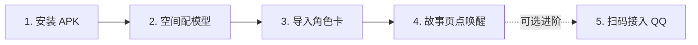

# HDS Android 📱🎭

> **让有温度的 AI 伴侣生活在你的手机里**  
> 免电脑、免云服务器、免敲代码，在 Android 手机上原生运行 [HDS-Interlude](https://github.com/ISEKAI-MomoiCore/HDS-Interlude) 的叙事、记忆与持续生活核心。

---

## 🌟 项目简介

**HDS-Android** 是专为 Android 手机打造的 HDS-Interlude 移动端原生运行器。

以往在手机上体验具有长期记忆的 AI 伴侣，要么需要一台开着机做服务器的电脑，要么得在手机 Termux 终端敲一大堆复杂的 Linux 命令行。**现在，这一切只需安装一个 APK 即可搞定！**

- 📱 **真正手机纯本地**：手机内置轻量化运行沙箱（PRoot + Node.js + SQLite WASM）。所有角色卡、对话剧情、长期记忆与心理状态档案，**完全保存在你的手机本地**，断网也能看，数据不经任何第三方中转。
- 🔒 **硬件级隐私保护**：你的 AI 模型 API Key 经由 Android Keystore 硬件级加密保存；AI 仅作为提供思考的大脑，所有的记忆和陪伴历程全属于你。
- 🏷️ **当前最新版本**：**`0.1.0-preview.8.2 · ARM64 · Android 8.0+`**。修复 preview.8.1 的图片发送回归：升级后即使开了图片理解也可能被"未确认支持图片"误拦，8.2 起未声明的模型不再拦截，只有明确不支持时才提示改用独立识图模型（详见 [preview 8.2 说明](docs/PREVIEW8.2.md)）；图片加号在识图未开启等情况给出明确提示并引导到设置；相册可一次多选（最多 3 张）；支持"七分钟后叫我"这类定时联系（时间不明确会明确拒绝并记入待办）；聊天翻看旧消息不再被强制拉回底部、发送失败可重试；见闻/长期记忆/当前心绪切换时保留滚动位置；日志默认更详细；大图查看更省内存不易闪退。👉 [**直达下载 preview.8.2 最新安装包**](#-极速上手教程)

---

## ✨ 核心亮点速览

| 功能模块 | 通俗介绍 |
| :--- | :--- |
| 🚀 **原位一键唤醒** | 打开 App，在「故事」页面点一下**「唤醒」**即可！系统自动在后台备齐运行环境并启动，AI 还在睡觉时也能提前打字存草稿，启动后自动就绪。 |
| 🎨 **液态玻璃新美学** | 采用半透明毛玻璃质感与浮动胶囊导航。你可以**自由上传自定义壁纸或立绘**，随意调节毛玻璃模糊度、暗度、文字大小和气泡风格（琉璃毛玻璃 / 经典纸质 / 无边框轻小说）。 |
| 📸 **支持发图与识图** | 聊天时随时可以拍照片或发送本地图片（最多 3 张）。AI 能看懂你分享的生活点滴！支持直接使用带视觉能力的大模型，也可单独配置便宜实用的“专属识图模型”。 |
| 🌿 **见闻与记忆管理** | 角色记错事情不再头疼！在「见闻」页面能一目了然查看角色当前的心情变化、长期记忆事实。支持**一键整理记忆**、**补充或停用特定事实**、**查看事实出处**以及**取消未完成的约定**。 |
| 🤖 **模型精细分工（聪明又省钱）** | 兼容 **OpenAI** 与 **Anthropic** 格式接口。支持将**主叙事**、**记忆提炼**、**心理分析 (Alter)** 和 **图片识别**分别指定给不同模型。用聪明的大模型推剧情，用便宜的小模型做总结，兼顾极高文笔与超低调用成本！ |
| 🎭 **主流角色卡导入** | 支持**酒馆（SillyTavern）PNG 卡片与 JSON 格式**（包含世界书与开场白），以及 [typ0](https://typ0.space/#browse) 下载的 `koishi.yml` / HDS 原生人设。每个角色拥有独立的数据档案。 |
| 💬 **手机本地 QQ 联动** | 手机端**直接扫码登录本地 QQ**，无需电脑挂机！把心仪的角色变成你的 QQ 好友或群聊搭子（群聊仅在被 @ 时响应），配有严格的白名单防打扰机制。 |
| 📦 **故事独立存档与随心重开** | 支持一键将当前故事打包导出为完整 ZIP 备份包，换机迁移超方便；想体验新故事时可以随时“从当前人设重新开始”，旧故事依然安全留存在本地备份中。 |

---

## 🚀 极速上手教程

从安装到开启互动，仅需简单四步：



### 第一步：安装最新安装包

从下方官方通道下载最新的 **preview.8.2** 安装包：

- 🏷️ **GitHub Release 快速下载**：前往 [v0.1.0-preview.8.2 Release 发布页](https://github.com/sl251/HDS-Android/releases/tag/v0.1.0-preview.8.2)（GitHub 标记为 Latest 的正式版本）直接点击下载 `HDS-Android-0.1.0-preview.8.2-arm64.apk`。
- 📦 **GitHub Actions 官方构建产物**：前往 [preview.8.2 Actions 构建详情页 (Run #38789636952)](https://github.com/sl251/HDS-Android/actions/runs/38789636952)，在页面下方的 **Artifacts** 列表中点击下载并解压。
- 🔐 **文件校验信息**：
  - 文件名：`HDS-Android-0.1.0-preview.8.2-arm64.apk`
  - SHA-256：`cd7ecc998d83e40481001a6e65a5e300d4e5866e891cbd358c481ea461061042`
  - 文件大小：186,998,829 字节（约 178 MiB）
  - 完整清单见 Release 附件 `SHA256SUMS.txt`，可用 `sha256sum -c SHA256SUMS.txt` 自行校验。

> [!IMPORTANT]
> **覆盖安装注意事项**：若手机里已安装旧版本，**请直接覆盖安装，千万不要先卸载**！  
> Android 系统在卸载应用时会连带清空私有存储。直接覆盖安装可完整保留已有的角色剧情、记忆数据、模型密钥以及 QQ 登录凭据。

### 第二步：配置 AI 模型（给伴侣接上大脑）

1. 进入底部导航的 **「空间」** 页面，展开 **「模型与识图」** 折叠区。
2. 点击 **「添加连接」**（或编辑现有连接）：
   - 选择预设平台（如 DeepSeek、OpenRouter、硅基流动、月之暗面、智谱、阿里百炼等）或填写自定义 Base URL。
   - 填入你的 **API Key**（数据将经硬件级加密安全保存在本机）。
   - 点击 **「获取模型列表」** 选择具体模型，或直接手动输入模型名称。
3. **分配任务**：为主叙事、记忆提炼、心理分析（Alter）和识图选择对应的连接（初学者让所有任务沿用主叙事即可）。
4. 点击 **「测试当前连接」**，确认连通成功后点击保存。

### 第三步：导入心仪的角色卡

在 **「空间」** 页面的 **「故事与身份」** 中：
- 点击 **「导入角色」**，直接选取你的酒馆角色卡图片（`.png`）、JSON 文件或 typ0 的 `koishi.yml`或分享码
- 也可以直接在 **「故事」** 页面点击顶部的角色名字，打开角色切换列表。

### 第四步：原位一键唤醒，开聊！

1. 切换到底部导航的 **「故事」** 页面。
2. 界面中央会显示唤醒面板，直接点击 **「唤醒」** 按钮。
3. App 会在原地自动解包运行环境并启动核心（仅首次使用或大版本更新时需要解包，耗时约 1 分钟）。
4. 状态变为绿色的 **“故事正在继续”** 后，输入框自动激活，即可开始发送文字与图片畅聊！

---

## 📱 界面四大板块介绍

底部导航采用更符合直觉的四大板块设计：

```
┌─────────┬─────────┬─────────┬─────────┐
│  📖 故事 │  🌿 见闻 │  📬 信箱 │  🌌 空间 │
└─────────┴─────────┴─────────┴─────────┘
```

- 📖 **故事（日常对话）**：
  - 沉浸式对话界面，支持实时发送文本与最多 3 张照片。
  - 点击顶部的角色名，随时弹窗切换不同主角或不同故事。
  - 核心未启动时直接原位显示“唤醒”按钮；休息时也能随时在输入框中打字备好草稿。
- 🌿 **见闻（记忆与心绪）**：
  - **当前心绪**：查看角色在当前剧情下最真实的心理状态与想法变化。
  - **时间线与长期记忆**：查看所有沉淀下来的事实与日常经历。
  - **记忆管理操作**：支持手动点击「立即整理记忆」、补充/停用某条事实、查看事实是由哪段对话生成的，或者取消尚未完成的约定待办。
- 📬 **信箱（手机本地 QQ 接入）**：
  - 手机端一键扫码登录 QQ，查阅与好友/群聊的消息流看板。
  - 提供双向手动发信功能，支持精确配置白名单。
- 🌌 **空间（管理与偏好）**：
  - **故事与身份**：角色卡的导入、编辑、切换与管理。
  - **模型与识图**：多供应商管理、模型列表拉取、多任务分工与独立识图模型指定。
  - **界面与阅读**：液态玻璃视觉调节，可自由上传背景立绘/壁纸，微调模糊度、暗度、正文字体与气泡风格。
  - **存档与故事管理**：一键导出完整 ZIP 备份、恢复已有存档，或选择“从当前人设重新开始”。
  - **核心维护**：高级环境重置与底层诊断日志。

---

## 💬 进阶玩法：手机本地 QQ 接入（信箱）

不用电脑挂机，不用云服务器，让角色直接成为你的 QQ 好友：

1. **准备组件**：确保 HDS 处于唤醒运行状态，切换到底部的 **「信箱」** 页面，点击 **「下载并准备组件」**（初次使用需下载约 235 MiB 组件，请保证手机至少留有 1.6 GiB 剩余空间）。
2. **启动与扫码**：点击 **「启动 QQ」**，等待二维码生成后，使用**手机官方 QQ 扫码授权登录**。
3. **确认通道在线**：等待信箱状态变为 **“QQ 与 HDS 消息通道已连接”**。
4. **安全白名单防打扰设置**：
   - 为避免无谓的模型 API 额度浪费与风控，**自动回复默认是关闭的**。
   - 点击 **「角色自动回复」**，在白名单中填入允许互动的 **QQ 好友账号** 或 **QQ 群号**。
   - 开启自动回复开关：白名单内的好友私聊将自动得到当前角色的回复；群聊中**仅在被 @ 时**才会触发角色回复。
5. **双向信箱互动**：在信箱页面可随时查看互动记录，也可以用当前登录的 QQ 身份手动给好友发送消息。

> [!TIP]
> 切换不同角色时，QQ 登录凭证依然保存在本机独立区域无需重复扫码；不同角色的白名单彼此独立。

---

## ⚠️ 使用建议与后台保活

> [!NOTE]
> - **系统支持**：Android 8.0 及以上，仅支持 **ARM64** 架构（近几年的绝大多数安卓手机均支持）。
> - **存储空间**：基础运行建议手机预留至少 **1.5 GB** 空间；若启用 QQ 组件，建议额外预留 **1.6 GB** 空间。
> - **国产手机后台保活三步法**：由于各大安卓定制系统（如 HyperOS、OriginOS、ColorOS、EMUI 等）对后台清理较激进，若想在锁屏或退回桌面后角色仍能持续思考、回复 QQ，请在系统设置中：
>   1. 将本应用加入**允许自启动 / 允许后台活动**白名单；
>   2. 将电池策略设置为**“无限制 / 不优化”**；
>   3. 在多任务后台给应用挂上**“锁定后台”**的小锁。
> - **QQ 规范**：建议使用小号体验；请合理配置白名单，避免在人数众多的大型陌生群聊中频繁触发。

---

## 🛠️ 常见问题解答 (FAQ)

<details>
<summary><b>Q1: 为什么点击“唤醒”后提示启动失败或一直转圈？</b></summary>

1. **检查手机剩余存储**：手机内部存储不足会导致运行沙箱解包或启动失败，请确保至少有 2GB 剩余空间。
2. **检查模型连接**：前往「空间」->「模型与识图」，点击「测试当前连接」，确认填写的 API Key 和 Base URL 能正常连通且账户有额度。
3. **查看提示或日志**：展开高级折叠区查看诊断日志；在部分特定系统机型上，已包含针对 seccomp 和环境探针的兼容机制。
</details>

<details>
<summary><b>Q2: 覆盖安装新版本后，我之前的人物故事和聊天记录会丢吗？</b></summary>

**绝对不会**。只要你直接下载 APK **覆盖安装**，所有聊天记录、故事演化、角色记忆、模型密钥以及 QQ 登录态都会完整保留。  
再次强调：**千万不要先卸载再安装**，安卓系统在卸载应用时会强制清空该应用私有目录中的全部文件。
</details>

<details>
<summary><b>Q3: 发送图片时提示失败，或者角色好像“看不懂”图片？</b></summary>

1. 图片理解需要模型具备视觉多模态能力。请确认你的**主叙事模型**是否支持图片输入。
2. 如果你的主叙事模型纯文本能力很强但不支持看图，可以在「空间」->「模型与识图」中，将**“识图模型”**单独指定给一个支持看图的模型。系统会让该模型先看图并把画面描述转给主模型继续推演。
</details>

<details>
<summary><b>Q4: 修改人设卡信息或调整了模型配置后，需要怎么生效？</b></summary>

- 外观（壁纸、毛玻璃、字体等）是**实时生效**的，调整滑块即可见效果。
- 修改了模型地址、密钥或人设参数后，界面会提示**“立即重启生效”**，点击一下即可自动重新载入配置，原有的故事和对话历史均会完整保留。
</details>

<details>
<summary><b>Q5: QQ 扫码登录成功了，为什么发消息角色不理我？</b></summary>

为了保护你的 API 额度不被盗刷，自动回复**默认是关闭的**。  
请前往「信箱」->「角色自动回复」，打开自动回复开关，并将你的 QQ 号（或所在群号）加入白名单列表。在群聊中，角色只有在被 `@` 时才会触发回复。
</details>

<details>
<summary><b>Q6: 想要开一段全新的故事，但又舍不得现在的记忆怎么办？</b></summary>

进入「空间」->「存档与故事管理」：
1. 先点击 **「导出完整存档」**，将当前角色的所有对话、记忆与图片一键导出为 ZIP 文件存到手机文件中。
2. 然后点击 **「从当前人设重新开始」**，即可开启一段空白的新日常；如果以后想重温，随时可以点“恢复存档”无缝切回。
</details>

---

## 📋 版本更新历史

- **`0.1.0-preview.8.2` (当前最新版本)**
  - 修复 preview.8.1 的图片发送回归：未声明图片能力的模型不再被拦截（恢复 preview.8 行为），只有明确不支持时才提示改用独立识图模型。
  - 验证状态：全量测试 46/46 通过；真机图片发送待用户在 8.2 上确认（2026-10-16）。
- **`0.1.0-preview.8.1`**
  - 图片：加号在识图未开启等五种情况给出明确提示并引导到「模型与识图」；相册支持一次多选（最多 3 张）；重启判定改用运行中配置，减少误报。
  - 定时联系：支持"七分钟后提醒我"这类约定并精确到秒；时间不明确时明确拒绝并写入待办；只有真实投递成功才算完成。
  - 聊天与见闻：翻看旧消息不再被强制拉回底部，新消息以角标提示；发送状态可见、失败可一键重试；见闻/长期记忆/当前心绪切换后保留滚动位置。
  - 日志与大图：默认日志级别更为详细；大图处理降低内存占用峰值。
  - 验证状态：维护者已在真机实测定时消息与图片发送通过（2026-10-16）。
- **`0.1.0-preview.8`**
  - 新增生活节奏与表达设置、分享码差异同步、滚动 24 小时后台模型预算及状态通知。
  - 接入 QQ 群引用回复；补充任务书审查与实际支持状态。
  - 维护者真机覆盖安装与角色卡导入验证通过；完整保活自愈与长时（Doze / 厂商后台）验收仍待完成，详见 [PREVIEW8.md](docs/PREVIEW8.md)。
- **`0.1.0-preview.7.1`**
  - 修复角色回复气泡的外层嵌套问题，去除了误引用的卡片外框与多余边距，恢复清爽优雅的单层回复气泡。
  - 继承 preview.7 的全部液态玻璃、图片输入与记忆管理特性。
- **`0.1.0-preview.7`**
  - **液态玻璃设计**：全新半透明毛玻璃质感、浮动导航胶囊与边缘高光，支持自定义壁纸立绘、毛玻璃模糊度、暗度、字号与浅深色模式。
  - **多模态发图与识图**：对话支持附加最多 3 张照片；支持独立配置识图辅助模型，主叙事模型可无缝接续画面观察。
  - **见闻记忆深度管理**：支持一键整理记忆、补充与停用事实、查看事实出处来源、取消约定待办，以及按范围清理性格演化。
  - **故事存档与新开日常**：支持导出/恢复完整 ZIP 存档包，支持从当前人设安全重新开局并保留本地备份。
- **`0.1.0-preview.6.1`**
  - 引入 iOS 风格主题外观定制面板，支持预设色盘、毛玻璃背景调节与字体切换。
- **`0.1.0-preview.6.0`**
  - 全新升级为「故事 / 见闻 / 信箱 / 空间」四大导航板块。
  - 实现原位一键唤醒机制，无需手动进入维护面板；支持休息期打字草稿。
- **`0.1.0-preview.5.4`**
  - 修复 OneBot 登录后的消息通道判定逻辑，彻底解决通道误判与无限重试问题。
  - 准确区分 QQ 登录态与消息在线通道，已登录状态不再反复弹出二维码。
- **`0.1.0-preview.5.0 ~ 5.3`**
  - 引入手机本地 QQ 接入（基于 Linux QQ + NapCat + OneBot 与 Xvfb 虚拟显示），新增 App 内置信箱。
  - 优化 Xvfb 锁文件处理，增加组件下载进度与 GitHub 加速通道。
  - 增加 PRoot 启动环境探针与 seccomp 模式回退，大幅提升国产定制系统的兼容性。
- **`0.1.0-preview.4` 及更早版本**
  - 引入全新多模型中心，支持主叙事 / 记忆 / Alter 精细分工与模型列表自动拉取。
  - 首条回复流式输出与 typ0 人设导入支持。

---

## 💻 开发者编译与构建

如果你想自行编译或向本项目贡献代码：

```sh
# 1. 安装前端与工作流依赖
npm ci --ignore-scripts
npm test

# 2. 同步资源至 Android 工程
npm run android:sync

# 3. 构建/准备运行时文件
python3 scripts/build-runtime.py

# 4. 构建 Release APK
cd android
./gradlew lintRelease testReleaseUnitTest assembleRelease
```

- **推荐构建环境**：Linux x86_64 / ARM64, Node.js 24.11.1, Python 3.12, OpenJDK 21, Android SDK 35。
- 完整打包流程可参考项目的 GitHub Actions 工作流配置文件。

---

## 📚 详细文档与参考

- 🆕 [Preview 8.2 修复图片发送回归](docs/PREVIEW8.2.md)
- [Preview 8.1 图片提示、定时联系与阅读体验修复](docs/PREVIEW8.1.md)
- 🆕 [Preview 8 生活节奏、分享码与后台模型预算](docs/PREVIEW8.md)
- 📱 [Preview 7 / 7.1 特性与机制说明](docs/PREVIEW7.md)
- 📖 [Preview 6 故事体验与原位唤醒设计](docs/STORY-EXPERIENCE-PREVIEW6.md)
- 🧪 [手机测试指南与测项清单](docs/TEST-ON-PHONE.md)
- 🤖 [模型中心设计与人设格式兼容说明](docs/MODEL-CENTER-AND-PERSONAS.md)
- 💬 [手机本地 QQ 架构与路线图](docs/QQ-ROADMAP.md)
- 🧩 [HDS 移动端补丁边界说明](docs/MOBILE-PATCHES.md)
- 📊 [功能盘点表口径说明](docs/feature-parity.md)（`docs/feature-parity.csv` 是上游 AST 机械盘点基线，不等于移动端支持声明）
- 📜 [第三方组件与开源许可证清单](docs/THIRD_PARTY.md)

---

## ⚖️ 开源协议与声明

- **本仓库采用 [GNU AGPL-3.0](LICENSE) 许可**，与上游核心 [HDS-Interlude](https://github.com/ISEKAI-MomoiCore/HDS-Interlude)（AGPL-3.0）保持一致。版权与附加组件说明见 [NOTICE.md](NOTICE.md)。
- 本项目包含 Ubuntu Base、Node.js、PRoot 等开源组件，遵循其各自开源许可证。
- QQ 与 NapCat 相关组件仅在用户主动点击时从官方/上游可信源下载并校验，安装包内未捆绑商业软件专有文件。
- 本项目仅供技术研究与个人学习使用，使用 QQ 联动功能时请自觉遵守腾讯 QQ 软件许可及服务协议。
