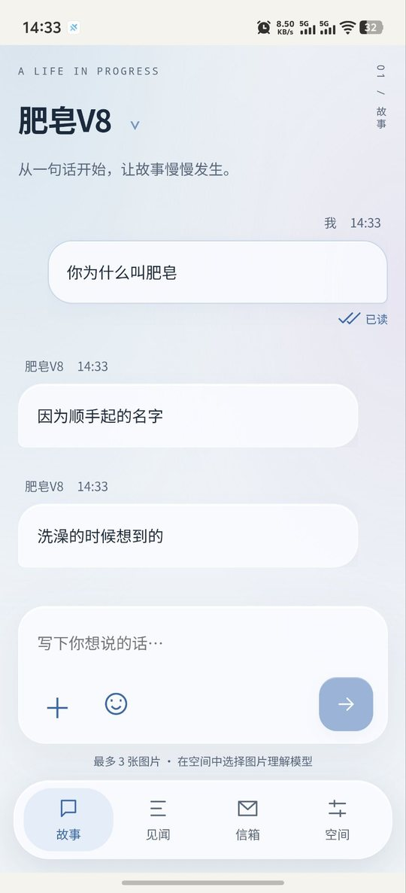
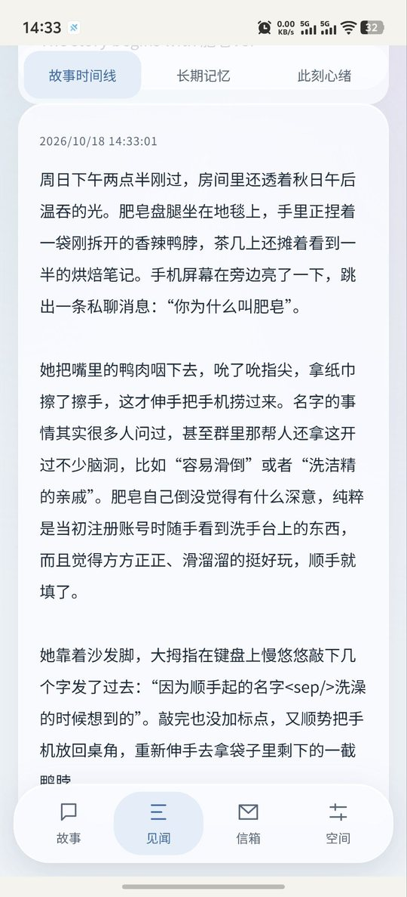
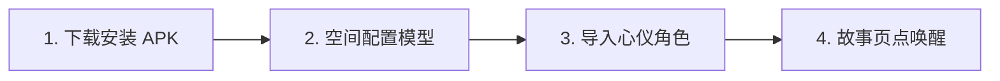
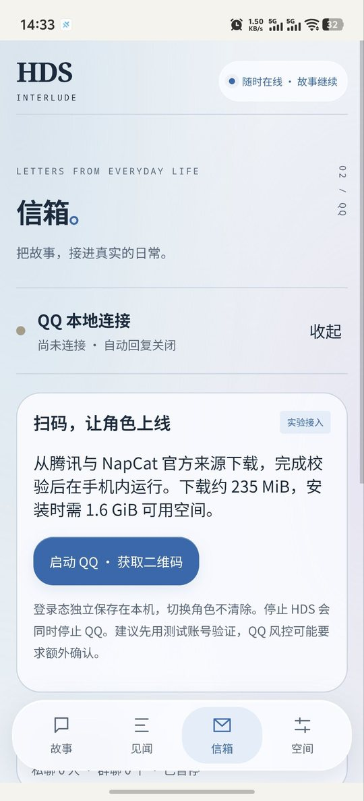

# HDS Android 📱🎭

> **让有长期记忆与真实心绪的 AI 角色，真正生活在你的安卓手机里。**  
> 免电脑挂机、免云服务器、免终端敲代码，在 Android 手机上完整运行 [HDS-Interlude](https://github.com/ISEKAI-MomoiCore/HDS-Interlude) 的叙事、记忆与持续生活引擎。

<p align="center">
  
</p>

---

## 🌟 HDS 是什么？它和“套壳聊天 App”有何不同

HDS（[HDS-Interlude](https://github.com/ISEKAI-MomoiCore/HDS-Interlude)）是一个专注于长期陪伴的 AI 角色引擎。市面上常见的“套壳聊天 App”，本质上只是把你的每句话加上一段固定的背景设定发给大模型，关掉软件或者聊得久一点，角色就会迅速“失忆”，一切又回到最初的模板回复。HDS 里的角色不是这样：它拥有会随时间沉淀、也会自我修正的长期记忆，有随经历起伏的情绪与心境，还有属于自己的生活节奏与日程。它不是一个被动回答问题的工具，而是一个有独立心智和生活轨迹的角色。

**HDS-Android 做的事，是把这套完整的角色引擎本体原样搬到了 Android 手机上。** 过去要在手机上体验这种深度的 AI 陪伴，你要么常年开着一台电脑当服务器，要么在手机的 Termux 终端里折腾一堆 Linux 命令行。现在，你只需要安装一个标准的 APK，就能把角色随身带着走。

最关键的是，HDS-Android 运行的是**上游引擎本体**（通过专为移动端设计的最小补丁做系统适配），不是在手机端重写一套偷工减料的简化仿制品。上游在记忆、情节推演、心理认知上的每一次迭代，都能原汁原味地落到你的手机体验里。

---

## 🏛️ 架构上真正领先的地方

1. **故事数据保存在本机，模型请求按需联网**  
   手机内置了无需 Root 的轻量化运行环境。角色卡、故事记录、长期记忆与心理档案保存在应用本地；断网时可查看已保存的内容。**生成回复、识图和云端语音仍需向你配置的模型或 TTS 服务发送必要的输入与上下文**；实验性 QQ 接入也会使用 QQ 客户端及其网络服务。项目本身不提供统一的云端聊天中转，但“本地保存”不代表数据从不发往第三方。
2. **完整引擎本体常驻，体验不断代、不缩水**  
   我们没有做一个只负责发网络请求的空壳界面，而是把整个生活引擎装进了手机。你得到的是与桌面端一致的情感推演深度和记忆沉淀逻辑，每次版本升级都原样继承核心能力。
3. **长期记忆与心理演化，透明可控**  
   日常相处中，角色会自己提炼出经历中的事实，好感与心境也会随剧情真实起伏。这些记忆对你完全透明：既能看到角色此刻的心情，也能查到某条记忆来自哪一段对话。角色记错了事，你可以补充、修正或停用那条记忆，也可以取消还没完成的约定。

   <p align="center">
     
   </p>

4. **分层大脑架构，文笔顶尖还很省钱**  
   兼容 OpenAI 与 Anthropic 两种主流接口格式，并支持模型分工调度：把“主叙事推剧情”“长期记忆提炼”“深度心理分析”和“看图”分别指派给不同模型。让文笔最好的模型负责聊天，让响应快、成本低甚至免费的轻量模型在后台整理记忆、分析心情，用极低的日常开销换来很强的沉浸感。
5. **API Key 在本机加密保存**  
   API Key 使用 Android Keystore 管理的 AES-GCM 密钥加密后保存在应用私有目录；**是否由硬件保护取决于设备及系统实现**。发起模型或语音请求时，应用会按需解密并向所选服务发送认证信息。建议使用 HTTPS；自定义非本机 HTTP 端点可能让密钥和请求内容暴露在传输链路上。
6. **克制自然的自主表达**  
   角色发表情包不是无脑刷屏，而是带情绪意愿判断：只在气氛合适、情绪到位时自己挑一张，既生动，也不打断你阅读。语音表达按同样的逻辑设计，但目前仍属实验性功能，详见下文。

---

## ⚡ 核心功能速览

| 功能模块 | 用户体验与亮点 |
| :--- | :--- |
| 🚀 **原位一键唤醒** | 打开 App 在故事页点「唤醒」即可启动运行，休眠时也能提前打字存草稿。 |
| 🌿 **长期记忆管理** | 角色沉淀的事实清单一目了然，可追溯对话出处，随时补充、停用或修改。 |
| 💓 **心境与情绪演化** | 实时查看角色当前的心理状态与好感变化，随剧情自然起伏。 |
| 🤖 **分层大脑精细分工** | 聊天写作、后台记事、看图识图可分别指派不同模型，质量高还省钱。 |
| 🎭 **角色自主表情包** | 导入表情包后，角色结合语境自己挑时机发送，无气泡直接呈现。 |
| 💬 **流式聊天与消息重试** | 正文逐步显示，发送失败可从原消息重试，连续消息合并等待与回车行为可设置。 |
| 📷 **语音输入与照片** | 支持拍照、相册、点按或按住录音，可试听或通过独立 STT 服务转成文字。 |
| 🌸 **故事动态** | 用户与角色可发动态、点赞和评论，互动按故事隔离，角色自主选择是否回应。 |
| 🖼️ **角色生图与独立头像** | 角色自主决定自拍与动态配图；头像可另外上传或按人设生成，与视觉档案独立保存。 |
| 🎨 **液态玻璃新美学** | 支持自定义背景立绘与壁纸，自由微调毛玻璃模糊度、字号与气泡质感。 |
| 📦 **备份与无痛重开** | 多角色卡独立切换，一键导出完整 ZIP 备份，或保留设定无痛新开日常。 |

> 说明：**角色自主语音**仍在实验阶段（目前只适配小米 MiMo 免费 TTS），已从核心功能表移出，见下文「实验性功能」一节。表情包与其余能力均为正式功能。

---

## 🚀 极速上手四步法



> [!IMPORTANT]
> **覆盖安装注意事项**：若手机里已安装旧版本，**请直接用新 APK 覆盖升级，千万不要先卸载**！  
> Android 系统在卸载应用时会清空该应用私有目录下的全部数据。直接覆盖安装，才能完整保留已有的角色剧情、记忆记录、模型密钥和 QQ 登录凭据。

### 第一步：下载并安装应用

- **最新版本**：`0.1.0-preview.9.6`（仅支持 **ARM64** 架构，需 **Android 8.0** 及以上系统）
- **官方下载地址**：[GitHub Releases 最新发布页](https://github.com/sl251/HDS-Android/releases/tag/v0.1.0-preview.9.6)
- **安装包文件名**：`HDS-Android-0.1.0-preview.9.6-arm64.apk`
- **文件大小**：189,326,822 字节（约 180.6 MiB）
- **SHA-256 校验码**：`3af732b36e41815aa0d347863634ed5e8e5421c3f521f78ddc9a2bc91a85bf22`
- **完整校验清单**：发布页附件提供了 `SHA256SUMS.txt`

### 第二步：配置模型大脑

1. 切换到底部导航的 **「空间」** 页面，打开 **「模型连接」**。
2. 点击 **「添加连接」**，选择主流预设平台（如 DeepSeek、OpenRouter、硅基流动、月之暗面、智谱清言、阿里百炼等）或填写自定义接口地址。
3. 填入 **API Key**（密钥在本机加密保存；是否具备硬件保护取决于设备）。
4. 点击 **「获取模型列表」** 选择具体模型，再点 **「测试聊天连接」**，确认连通后保存。
5. 返回空间，打开 **「任务分工」**，统一为主叙事、记忆压缩、心理分析、世界播种、图片识别、向量检索和重排序分配连接；记忆压缩和心理分析可沿用主叙事。向量请选 Embedding 模型，重排序请填专用模型名。

### 第三步：导入心仪角色卡

- 在 **「空间」** 页面的 **「角色与故事」** 中点击 **「导入角色」**。
- 支持酒馆（SillyTavern）PNG 角色图片、JSON 人设文件、[typ0.space](https://typ0.space/#browse)（HDSI 配置分享站）的 `koishi.yml` 设定，或分享码。
- 分享码导入后会**直接存成角色卡**，不用先开故事；重复导入不会覆盖你改过的人设。
- 也可以直接点「故事」页顶部的角色名，打开角色切换列表。

### 导出与备份角色

在「空间」的角色库中选中角色，点击「导出角色」即可，**无需唤醒故事**。可选四种格式：

- **原格式角色卡 JSON（推荐）**：尽可能保留已保存的开场白、世界书与扩展，PNG 卡以 JSON 导出；
- **SillyTavern V2 角色卡 JSON**：可导入酒馆；
- **HDSI 预设 JSON**：用于 HDSI / [typ0.space](https://typ0.space/#browse)；
- **YAML**：便于阅读与分享的 HDSI 预设视图。

导出的是**角色库中保存的人设版本**，并非运行中故事的临时修改；HDSI 预设和 YAML 转换不保证完整保留酒馆专用扩展。应用会过滤已识别的连接凭据字段；仍建议分享前自行检查人设中的私人信息。Android 端会弹出**系统保存位置选择器**，保存成功后也可使用「复制内容」。

### 第四步：原位一键唤醒开聊

1. 切换到底部导航的 **「故事」** 页面。
2. 界面中央会显示唤醒面板，直接点 **「唤醒」**。
3. 应用自动在后台准备运行环境并启动核心（仅首次使用或大版本升级时需解包，约 1 分钟）。
4. 状态变为绿色的 **“故事正在继续”** 后，输入框自动就绪，可以开始发文字和照片了。

---

## 📱 界面四大板块介绍

底部导航采用四个板块：

```
┌─────────┬─────────┬─────────┬─────────┐
│  📖 故事 │  🌿 见闻 │  📬 信箱 │  🌌 空间 │
└─────────┴─────────┴─────────┴─────────┘
```

- 📖 **故事（日常相伴）**：主对话界面，支持流式文字、消息重试、语音录音与最多 3 张照片；照片可拍摄或从相册选择。点顶栏角色名可切换角色或故事线；核心休眠时也能先在输入框写草稿。
- 🌿 **见闻（心绪与记忆）**：查看角色的心理状态、实时想法与沉淀下来的长期记忆；可回溯事实出处、手动整理记忆、修改或停用事实、取消未完成的约定。
- 🌸 **动态（故事里的朋友圈）**：用户和角色可以分享日常、点赞和评论；不同故事互相隔离，角色可以选择是否回应互动。
- 🌌 **空间（管理与个性化）**：角色导入导出与切换、音色工作台、多模型连接与任务分工、液态玻璃视觉定制（壁纸/毛玻璃/字号）、核心维护与诊断日志，以及完整 ZIP 存档的导出与恢复。

「信箱与外部连接」已移入空间，保留外部消息记录、双向发信和实验性 QQ 接入。STT 与生图在「语音识别与生图」配置；「角色头像」管理聊天和动态头像，「角色视觉档案」管理自主生图时的外观与画风。

---

## 🧪 实验性功能

这里的两个功能（**本地 QQ 接入**与**角色语音**）都还在打磨中，**不算本项目的核心能力**：它们分别依赖第三方客户端和第三方语音服务，接口、稳定性与效果都可能随对方更新而变化。想尝鲜可以开，但请把下面的风险当作已知条件。

### A. 手机本地 QQ 接入（信箱）

> [!WARNING]
> **这是实验性功能。** 它依赖手机本地虚拟环境运行轻量 Linux QQ 与协议组件，可能因腾讯客户端协议更新、账号风控或安卓后台清理策略而连接中断、掉线。请先了解：
> - **建议用小号**：仅供个人研究体验，不要用于营销、广告或敏感群聊，以免主力账号被风控。
> - **白名单防打扰**：为保护 API 额度，**角色自动回复默认关闭**。需要你在白名单里手动加入允许互动的 QQ 好友或群号；群聊中角色**仅在被 @ 时**才回复。

<p align="center">
  
</p>

### 启用步骤

1. 确保 HDS 处于唤醒状态，进入 **「空间 → 信箱与外部连接」**，点 **「下载并准备组件」**（初次使用需下载约 235 MiB 组件，请保证手机至少 1.6 GiB 剩余空间）。
2. 点 **「启动 QQ」**，等二维码生成后，用**手机官方 QQ 扫码**授权登录。
3. 状态变为 **“QQ 与 HDS 消息通道已连接”** 后，在「角色自动回复」里添加白名单并打开开关。
4. 在信箱页可以随时查看互动记录，也能用当前登录的 QQ 身份手动给好友发消息。

> [!TIP]
> 切换角色不用重新扫码：QQ 登录凭证保存在本机独立区域；每个角色的白名单各自独立。

### B. 角色自主语音（实验）

> [!WARNING]
> **语音同样是实验性功能。** 目前只适配[小米 MiMo 开放平台](https://platform.xiaomimimo.com)的 TTS（`mimo-v2.5-tts` / `mimo-v2.5-voiceclone` / `mimo-v2.5-voicedesign`）。这几个模型现在免费，但后续是否收费、接口是否变动都不由本项目决定；合成要联网，语速、情感与音色效果也仍在打磨。

开启方式：

1. 去[小米 MiMo 开放平台](https://platform.xiaomimimo.com)注册并创建 API Key（格式 `sk-xxxxx`，端点 `api.xiaomimimo.com`）。
2. 在「空间」->「角色语音与音色」填入密钥，用现场录音克隆、导入参考音频或文字描述设计声线。
3. 进角色设置打开语音开关并绑定音色。

设计上的克制：角色保留意愿阈值与发送冷却，不会一直发语音；不再设置本机每日语音 Token 预算。合成失败会静默退回文字，不会出现“语音没到、文字也没到”。完整说明见 [docs/PREVIEW9.md](docs/PREVIEW9.md)。

---

## ⚠️ 使用建议与后台保活

- **设备与系统要求**：Android 8.0 及以上，处理器须为 **ARM64** 架构（近几年绝大多数主流安卓手机都支持）。
- **存储空间建议**：基础运行建议预留至少 **1.5 GB** 可用空间；启用本地 QQ 实验组件时，再额外预留 **1.6 GB**。
- **国产手机后台保活三步法**：  
  各大国产定制系统（HyperOS、OriginOS、ColorOS、MagicOS、EMUI 等）清理后台比较激进。想在锁屏或退回桌面后角色仍能继续思考、整理记忆或接收消息，请在系统设置里完成三步：
  1. **允许自启动与后台活动**：在「应用信息」中打开“允许自启动”“允许后台运行”。
  2. **电池策略设为无限制**：在电池与省电设置中改为“无限制 / 不优化”。
  3. **多任务卡片加锁**：进多任务界面，下拉或长按本应用卡片，点上“锁定”小锁，防止被一键清理。

---

## 🛠️ 常见问题解答 (FAQ)

<details>
<summary><b>Q1: 覆盖安装新版本后，我之前的人物故事和聊天记忆会丢吗？</b></summary>

**不会**。只要直接下载新版 APK **覆盖安装**，所有剧情、记忆演化、模型密钥和 QQ 登录态都会完整保留。再提醒一次：**千万不要先卸载再安装**，安卓系统在卸载时会清空该应用的私有存储目录。
</details>

<details>
<summary><b>Q2: 点击“唤醒”后提示启动失败或一直转圈怎么办？</b></summary>

1. **检查剩余存储**：运行沙箱需要解包和写入空间，请确保机身存储至少还有 2 GB 可用。
2. **检查模型连接**：前往「空间」->「模型连接」，点「测试聊天连接」，确认 API Key 和请求地址正确、账户额度充足。
3. **查看诊断日志**：展开高级折叠区可看环境诊断日志；应用已内置针对不同机型的环境兼容探针。
</details>

<details>
<summary><b>Q3: 发送图片时角色看不懂，或者提示发送失败？</b></summary>

1. 看图需要模型本身具备视觉能力，请确认主模型是否支持图片输入。
2. 如果主模型擅长写文但不支持看图，可在「空间」->「任务分工」->「图片识别与理解」里单独指定一个“识图模型”。系统会让它先看图，再把画面细节转述给主模型继续推演。
</details>

<details>
<summary><b>Q4: 改了模型设置或人设卡，怎么让它生效？</b></summary>

- 外观设置（壁纸、毛玻璃、字号等）**实时生效**，滑动即可见。
- 改了模型接口、密钥或角色核心参数，界面会提示**“立即重启生效”**，点一下自动重新载入配置，当前故事和历史都完好保留。
</details>

<details>
<summary><b>Q5: 想开一段新故事，又舍不得现在的记忆怎么办？</b></summary>

进入「空间」->「存档与故事管理」：
1. 先点 **「导出完整存档」**，把当前角色的对话、记忆与图片导出为 ZIP 存到手机里。
2. 再点 **「从当前人设重新开始」**，清爽开一段新日常；想重温旧回忆，随时点“恢复存档”切回去。
</details>

<details>
<summary><b>Q6: 表情包在哪导入？</b></summary>

进入聊天页右上角 **设置 ->「表情包」**，可多选图片或**整文件夹导入**（文件夹名自动成为表情包名），也能在管理页重命名、删除贴纸包。注意：**贴纸库为空时输入框旁的表情入口是隐藏的**，导入第一张后才会出现。贴纸库全局共享，导入后角色自动拿到贴纸清单，不用逐个角色配置。
</details>

<details>
<summary><b>Q7: 语音功能怎么开？（实验性）</b></summary>

> 语音目前是**实验性功能**，只适配小米 MiMo，接口与资费可能变化，详见上文「实验性功能」一节。

1. **拿密钥**：去[小米 MiMo 开放平台](https://platform.xiaomimimo.com)注册并创建 API Key（格式 `sk-xxxxx`，端点 `api.xiaomimimo.com`）。`mimo-v2.5-tts` / `mimo-v2.5-voiceclone` / `mimo-v2.5-voicedesign` 目前免费。
2. **配音色**：在「空间」->「音色工作台」填密钥，用现场录音克隆、导入参考音频或文字描述设计声线。
3. **开语音**：进角色设置打开语音开关并绑定音色。角色保留意愿阈值和发送冷却，已移除本机每日语音预算；合成失败会静默退回文字。
4. 完整说明见 [docs/PREVIEW9.md](docs/PREVIEW9.md)。
</details>

<details>
<summary><b>Q8: 为什么 QQ 扫码成功了，发消息角色不理我？</b></summary>

为保护 API 额度，自动回复**默认关闭**。请进入「空间 → 信箱与外部连接」->「角色自动回复」，打开开关，并把你的 QQ 号（或所在群号）加进白名单。群聊里角色只在被 `@` 时回复。
</details>

---

## 📋 版本更新历史

<details>
<summary><b>点击展开各版本更新说明（最近更新：preview 9.6）</b></summary>

- **`0.1.0-preview.9.6`**
  - 流式输出、失败重试、连续消息合并；拍照、相册、录音与 STT。
  - 按故事隔离的动态、点赞和评论；角色自主决定回应、自拍与动态配图。
  - 独立角色头像上传/生成、视觉档案与免费生图渠道；主题配色、通知形式和设置布局优化。
  - 详细说明见 [Preview 9.6](docs/PREVIEW9.6.md)，[签名安装包、源码与校验文件已发布](https://github.com/sl251/HDS-Android/releases/tag/v0.1.0-preview.9.6)。
- **`0.1.0-preview.9.5.3`**
  - 聊天页新增角色「正在输入」气泡：按真实回合处理状态显示，圆点 1～3 个循环，提交状态单独呈现；回复投递、失败、不回复、延迟回复、核心停止或状态查询失效后自动收起，并支持系统减少动态效果。
  - 「空间」新增独立的「任务分工」入口：一处集中管理主叙事、记忆压缩、心理分析、世界播种、图片识别、向量检索与重排序的连接分配；连接页只维护连接资料，备用模型回归所属任务。
  - 移除向量任务下拉、连接高级分工与记忆页的重复入口；旧向量显式连接、模型名与端点原样保留，无需重填密钥，新分配继续同步兼容旧任务标记；表情包识图与记忆配置统一跳转到任务分工。
  - 顺带并入未单独发布的 9.5.2 检索修复：向量路由统一、索引身份校验与同栈检索探针，外部重排序默认关闭；覆盖安装保留角色、记忆与登录凭据，不要先卸载。
- **`0.1.0-preview.9.5.1`**
  - 安全更新：应用内嵌 Node.js 运行时升级到 24.22.1，修复压缩组件越界写入漏洞（CVE-2026-111497），并核验官方 SHA-256。
  - 依赖加固：undici、Vite、Capacitor、tar、basic-ftp 等升级到 2026 年 10 月安全版本；165 项单元测试与生产构建全部通过。
  - 这是安全补丁版，没有新功能、无交互变化；覆盖安装即可，角色、记忆与登录凭据照常保留。
- **`0.1.0-preview.9.5`**
  - 大修模型调用稳定性：超时、断网、限流和服务商故障会自动重试；密钥错误、配额用完直接换下一个连接，不再把好连接打入 5 分钟冷却。
  - 主叙事超时 60→90 秒，单轮 240 秒总上限；Wi-Fi/流量切换后 DNS 自动恢复，不再连环失败。
  - 消息诊断重做：每条消息一张卡片，六步管道一眼看出卡在哪，失败原因附人话建议；聊天页失败消息可直接跳转定位。
  - 底部四个板块支持左右滑动切换，带过渡动效；音色工作台排版修复，文字不再贴边框。
  - 新增七步新手引导，首次打开手把手过一遍主要功能；可在设置中重看。
  - 覆盖安装保留角色、记忆和登录凭据，不要先卸载。
- **`0.1.0-preview.9.4.1`**
  - 修好了预览 9.4 的表情投递：文字后的表情重新随正文发送，独立表情单独发送，文字和语音可以同时出现。
  - 语音意愿现在能穿过延迟回复、分段队列和重启恢复，不会莫名退回纯文字。
  - 语音回执缺失和超时会分开记录；表情素材缺失时整条发送失败，不再出现空白“已发送”消息。
  - 覆盖安装保留角色、记忆和登录凭据，不要先卸载。
- **`0.1.0-preview.9.3`**
  - 分享码导入后直接变成角色卡，不用先开故事；重复导入不会覆盖你改过的人设。
  - 角色卡可以单独导出成文件（酒馆卡图片、HDS 预设 JSON、YAML），备份和分享都方便。
  - 修好了没配识图模型时导入表情包会失败的问题；表情、语音、文字不再重复叠加发送。
  - QQ 里的表情现在按真表情发送，不再被当成普通图片。
  - 实验性的语音改成先合成成功再发，失败自动退回文字，不会出现“语音没到、文字也没到”。
- **`0.1.0-preview.9`**
  - 角色会自己发表情包了：按语境挑贴纸，无气泡直接显示；贴纸库为空时自动只发文字。
  - 实验性功能：角色会自己发语音了，还带音色工作台——小米 MiMo 免费语音，可录音克隆或文字定制声线，并有节制机制防刷屏。
  - 消息有了已读双勾、发送失败点击重试、正在输入气泡，输入法误发送也修了。
  - 设置页重排成个性化、智能、数据三层，角色卡移到顶栏，信箱可以折叠。
- **`0.1.0-preview.8.x`**
  - 完善日常节奏与定时联系，角色能在约定时间主动找你。
  - 相册支持一次选最多 3 张照片；模型不支持看图时给出明确提示。
  - 加了 24 小时后台模型用量预算护栏，后台整理记忆不会偷偷超支。
- **`0.1.0-preview.7.x`**
  - 液态玻璃视觉上线：自定义壁纸立绘、毛玻璃模糊度、字号与气泡质感。
  - 支持看图，并可单独配置便宜的识图模型配合主模型。
  - 见闻页可深度管理记忆，支持导出与恢复完整故事 ZIP。
- **`0.1.0-preview.6.x`**
  - 重构成「故事 / 见闻 / 信箱 / 空间」四大底部板块。
  - 原位一键唤醒，不用再进维护界面；休眠时也能提前打字。
- **`0.1.0-preview.5.x`**
  - 首次加入手机本地 QQ 接入（实验性），免电脑挂机也能和 QQ 好友互动。
  - 增强国产定制系统兼容性，运行环境启动更稳。
- **`0.1.0-preview.4.x` 及更早**
  - 引入多模型中心与分工调度，主叙事、记忆提炼、心理分析可分别接不同模型。
  - 首条回复支持流式打字机输出，兼容酒馆卡与 typ0 人设导入。

</details>

---

## 🔮 下一步计划

- ⌨️ **输入手感优化**：打磨软键盘弹出时的界面避让与流畅度。
- 🎙️ **适配更多语音服务**：接入更多云端 TTS 与本地离线合成引擎。
- 🗣️ **语音识别与生图兼容性**：补充更多真实服务和设备的验收，完善参考图与后台恢复体验。
- 📞 **双向实时通话探索**：尝试低延迟的端到端语音通话。

---

## 💻 开发者编译与构建

```sh
# 1. 安装前端与工作流依赖
npm ci --ignore-scripts
npm test

# 2. 同步资源至 Android 工程
npm run android:sync

# 3. 构建/准备运行时文件
python3 scripts/build-runtime.py

# 4. 构建 Release APK
cd android
./gradlew lintRelease testReleaseUnitTest assembleRelease
```

- **推荐构建环境**：Linux x86_64 / ARM64，Node.js 24，Python 3.12，OpenJDK 21，Android SDK 35。
- 完整打包流程见项目的 GitHub Actions 工作流配置。

---

## 📚 详细文档与参考

- 🆕 [Preview 9 角色自主表情包、自主语音与音色工作台](docs/PREVIEW9.md)
- [Preview 8.2 修复图片发送回归](docs/PREVIEW8.2.md)
- [Preview 8.1 图片提示、定时联系与阅读体验修复](docs/PREVIEW8.1.md)
- [Preview 8 生活节奏、分享码与后台模型预算](docs/PREVIEW8.md)
- 📱 [Preview 7 / 7.1 特性与机制说明](docs/PREVIEW7.md)
- 📖 [Preview 6 故事体验与原位唤醒设计](docs/STORY-EXPERIENCE-PREVIEW6.md)
- 🧪 [手机测试指南与测项清单](docs/TEST-ON-PHONE.md)
- 🤖 [模型中心设计与人设格式兼容说明](docs/MODEL-CENTER-AND-PERSONAS.md)
- 💬 [手机本地 QQ 架构与路线图](docs/QQ-ROADMAP.md)
- 🧩 [HDS 移动端补丁边界说明](docs/MOBILE-PATCHES.md)
- 📊 [功能盘点表口径说明](docs/feature-parity.md)（`docs/feature-parity.csv` 是上游 AST 机械盘点基线，不等于移动端支持声明）
- 📜 [第三方组件与开源许可证清单](docs/THIRD_PARTY.md)

**相关平台（第三方）**：[typ0.space](https://typ0.space) —— HDSI 配置/人设分享站，可浏览、下载和上传他人分享的角色设定与预设。

---

## ⚖️ 开源协议与声明

- 本仓库采用 [GNU AGPL-3.0](LICENSE) 许可，与上游核心 [HDS-Interlude](https://github.com/ISEKAI-MomoiCore/HDS-Interlude)（AGPL-3.0）一致。版权与附加组件说明见 [NOTICE.md](NOTICE.md)。
- 本项目包含 Ubuntu Base、Node.js、PRoot 等开源组件，遵循各自许可证。
- QQ 与 NapCat 相关组件仅在用户主动点击时从官方/上游可信源下载并校验，安装包内未捆绑商业软件专有文件。
- 本项目仅供技术研究与个人学习使用，使用 QQ 联动功能时请遵守腾讯 QQ 软件许可及服务协议。
