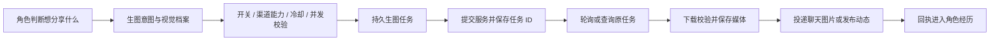

# HDS Android 下一阶段体验设计方案

版本：设计基线 v1 · 2026-10-23。本文保留最初方案与可选扩展；用户已授权实施，当前已实现范围和验证边界见 [实施与验证记录](NEXT-EXPERIENCE-IMPLEMENTATION-2026-10-23.md)，以该记录为准。未调用线上付费模型或实际生图。

## 1. 目标与已确认选择

把 HDS Android 的日常使用收敛到「聊天、见闻、动态、空间」四个主要场景，完善真实流式、失败恢复和多媒体输入，同时保留上游的生活、记忆与自主表达机制。

用户已经确认：

- 语音同时支持「发送语音消息」和「语音转文字后编辑发送」。
- 动态按故事隔离，用户也可以发布；角色可点赞、评论、回复，也可以不回应。
- 生图支持角色自主调用，覆盖自拍、聊天发图、动态配图；需要角色外观与风格定制。
- 加入用户提供的 imagefree 免费渠道作为可选生图适配器；其他 STT / 生图服务尚未确定。
- 天气先检查，有问题再修；没有复现或证据时，不为了改动而更换实现。
- QQ 与信箱移动入口，保留已有功能和数据。

建议沿用 React + Capacitor + 本地 Node/Koishi/HDS 的架构。主叙事、记忆、生活调度保持上游机制；移动端补充交互、传输、媒体任务和本地动态适配。

## 2. 已核对的现状

### 2.1 基线

| 来源 | 审阅基线 | 说明 |
|---|---|---|
| 本地 Android 工作区 | `c54de3f068c6cd970d8fd03af4e30acaae759bcd`，Preview 9.5.2 | 本轮源码审阅主体 |
| Android 远端最新提交 | `a61bda89382243536b2ce65ebd69090a7777d676`，README 标记 Preview 9.5.3 | 对比领先本地 3 个提交；差异为发布配置、版本、锁文件、文档，本方案涉及的功能源码没有变化 |
| 内置上游基线 | `ab512ec6b9dc00b9f738c062fe576e711a739151`，rc57，加移动端补丁 | 以 `docs/MOBILE-PATCHES.md` 为依据；不能把 vendored 目录当作没有补丁的原版 |
| 上游远端 | `9bdd5ac776dd682911edb9b48d1e7eaedd720dbe` | 比固定基线多 5 个提交；实施时逐项核对已回移修复，避免直接覆盖移动端补丁 |
| imagefree-skill | `3089c679e74f6a1fae01020d3534079220266e34` | 已读 SKILL、operations 与生成脚本；未验证当前网站线上生成成功率 |

### 2.2 现有能力与真正缺口

| 项目 | 源码证据 | 设计结论 |
|---|---|---|
| 流式 | `ModelCenter.tsx` 已有「流式首条回复」；`narrator.ts` 在 `extractEarlyNarrativeReply` 得到完整回复后调用 `onEarlyReply` | 已有 SSE 与提前投递基础，但没有逐字气泡链路；不能仅改开关或用打字动画当作完成 |
| 重试 | `main.tsx` 发送失败保留草稿并复用 requestId；`host.ts` 对 accepted 请求去重；`MessageFailureHint.tsx` 对模型失败仅提供诊断入口 | 需要分别补齐「重试提交」和「重试生成」，并把失败消息持久显示在原位置 |
| 私聊防抖 | `mapMobileConfig()` 固定 `userMessageDebounceSeconds: 1`；上游 `TurnEngine` 已实现消息落库、定时合并和过时请求处理 | 已接入 1 秒合并；应开放设置并验证行为，不另建一套并行防抖队列 |
| 语音输入 | 现有 TTS、录音与音色模块；上游所谓 voice-transcription 测试实际覆盖 OneBot 音频提取和原生音频输入 | 独立 STT 服务接入及本地聊天语音流程仍需新增，不能直接称上游已有完整 STT |
| 生图 | 现有角色表情和 TTS 的意愿、能力、投递机制 | 可复用机制，但需新增生图任务与生成图片资产，不能把任意图片伪装成表情包 |
| 相机 | `HdsRuntimePlugin.pickImage()` 走 `ACTION_OPEN_DOCUMENT`，现有附件上限 3 张 | 补相机入口，保留相册与现有压缩/识图链路 |
| 动态 | 宿主强制 `qzone.enabled=false`；上游有 Qzone 意图、感知、投递账本 | 复用感知与行动分离，不把本地动态绑到 QQ 登录或 SnowLuma |
| 天气 | 使用 Open-Meteo、故事地点解析、手动坐标回退；缺少用户可见的来源和错误状态 | 有需要验证的风险路径，尚不能断言用户手机已有天气故障 |
| 底栏光条 | `glass.css` 将指示线宽设成整个导航的约 1/4，用整体平移定位 | 改成活动按钮内部的短光条，避免视觉跨格与响应式误差；本轮未复现用户机型上的像素位置 |
| 通知 | 已有开关、Android 高重要性渠道、23:00–08:00 固定静音、前台不通知 | 扩展提醒形式、分类、时间段与前台行为，不重建后台消息接收系统 |

## 3. 页面布局与入口

底部保留四栏：**故事｜见闻｜动态｜空间**。保留现有「故事」名称，减少迁移成本；这一栏承担聊天功能。

```text
故事                           见闻
  角色头像、名称、状态             故事时间线 / 长期记忆 / 心绪
  私聊、图片、语音、生图             约定与待办
  顶部「…」→ 当前聊天设置

动态                           空间
  当前故事的动态流                  角色与故事
  用户与角色发帖                    模型中心 / 任务分工
  点赞、评论、回复                  角色视觉档案 / 语音与音色
  互动通知                        信箱
                                 设置 ⚙
                                   聊天与输入
                                   消息通知
                                   外观
                                   天气与地点
                                   扩展接入 → QQ（实验）
                                   备份与维护
```

信箱作为「空间」首页的独立条目，显示未读角标；页面保留外部会话、收信与发信。QQ 安装、扫码、白名单和连接管理统一放入「设置 → 扩展接入 → QQ」，信箱右上角提供连接管理快捷入口。QQ 未启用时不在主界面占大块位置；旧信箱数据和登录凭据不动。

设置必须有明确标题和返回路径。主界面顶栏可放齿轮直达设置；聊天顶栏的「…」只管理当前聊天及其覆盖项，避免把全局设置塞进角色详情。

### 3.1 聊天输入区

```text
┌────────────────────────────────┐
│ 头像  角色名        正在输入…  … │
│                                │
│ 角色气泡：逐步出现的回复文字…     │
│                    用户消息气泡 │
│                   ! 未送达 重试 │
│                                │
│ 待发照片缩略图 ×   录音草稿 ▶    │
│ [语音] [ 输入消息，自动增高 ] [☺]│
│                          [+ / 发送]│
│ 扩展面板： 相册  拍摄  语音转文字 │
│           发起生图（配置后显示） │
└────────────────────────────────┘
```

- 输入区交互参考微信/QQ，继续保留 HDS 的壁纸、玻璃材质与角色氛围。
- 输入框最多显示约 5 行；文本、附件或录音草稿存在时有明确发送按钮。
- 拍照或相册选取后先预览，支持移除；不会拍完直接误发。第一阶段继续每条最多 3 图。
- 键盘打开时收起主底栏，输入区贴合键盘；扩展面板和键盘不同时占据空间。返回键优先关闭面板、录音预览或键盘。
- 选图、拍摄、转写期间绑定开始操作时的 cardId/storyId；切换故事后不能把结果送入新故事。
- 长按菜单先保留复制、查看详情，再按消息状态提供重试；重新生成与重新发送明确区分。

### 3.2 输入与聊天设置

| 设置 | 建议行为 |
|---|---|
| 回车键 | 「发送消息 / 换行」二选一；新安装默认换行；老用户保留原来回车发送的习惯 |
| 外接键盘 | 发送模式中 Shift+Enter 换行；换行模式中 Ctrl+Enter 发送；发送按钮始终可用 |
| 中文输入法 | 候选确认、composition、keyCode 229 均不能触发发送 |
| 连续消息合并 | 关闭 / 1 秒 / 2 秒 / 3 秒 / 5 秒；高级输入允许上游 0–15 秒范围；新安装建议 2 秒，迁移旧用户保留 1 秒 |
| 回复显示 | 自动流式 / 完整显示；服务不支持流式时显示真实等待状态，再一次呈现完整回复 |
| 当前聊天覆盖 | 可覆盖消息合并与通知；显示是否沿用全局设置 |

### 3.3 底部光条

使用活动按钮内部居中的 20–24dp × 3dp 圆角短条，配轻微光晕；活动按钮仍有柔和底色。短条不参与布局、不跨按钮平移、不硬编码四栏宽度。容器处理安全区与裁剪，减少动态效果时关闭移动动画。验收包括 320/360/390dp、大字体、横屏、键盘和手势/三键导航。

## 4. 聊天可靠性：流式、重试、防抖必须一起设计

### 4.1 共同的数据边界

一个用户消息有稳定 `messageId/requestId`；一次合并处理有 `turnId` 和 `sourceMessageIds[]`；每次真正模型调用有 `attemptId`。三者分开，才不会把一次重试变成第二条用户消息，也不会把多条合并消息误算成多个失败回合。

建议新增持久状态，保留旧字段的兼容投影：

| 层次 | 关键状态 | 用户看到的状态 |
|---|---|---|
| 用户消息 | queued / submitting / accepted / submit_failed / submit_unknown | 等待发送 / 正在发送 / 已送达核心 / 未送达 / 正在确认 |
| 角色回合 | waiting / generating / streaming / completed / failed / interrupted / no_reply / delayed | 等待合并 / 正在输入 / 气泡增长 / 完成 / 回复失败 / 回复中断；无回复和稍后回复不是故障 |
| 媒体任务 | queued / submitted / running / ready / failed / unknown / cancelled | 正在转写或生成 / 完成 / 重试 / 等待确认 |

持久 outbox 保存正文、附件引用、所属故事和提交状态。重启后失败气泡仍在；明确失败与结果未知分开；短暂的诊断日志不能充当唯一业务状态来源。

### 4.2 真流式输出

1. 复用 OpenAI 兼容和 Anthropic 的现有 SSE 读取；能力不匹配的协议使用完整回复路径。
2. 为 `interaction.reply.content` 增加增量事件钩子。只在确认当前回复是允许展示的 immediate 回复后显示；不把剧本、结构化 JSON、模型思考内容或尚未判定的动作展示到气泡。
3. 使用增量 JSON 字符串解析，正确处理转义、中文、emoji、跨 chunk 字符和分段标记。不能用正则截取半个 JSON，也不能在完整响应回来后伪造逐字流式。
4. 新增 `reply.started / delta / segmentCompleted / completed / failed` 事件；都携带故事、回合、尝试、消息 ID、序号。Node → Android 服务 → Capacitor 监听器 → React；正常渲染按约 30–60ms 批处理，避免每个 token 触发全列表更新。
5. 前台用事件更新，重新进入页面或监听断开后按序号读取快照补齐；现有历史轮询只保留作校准。以 `messageId + seq` 去重，最终消息按同一 ID 定稿。
6. 流式草稿定期做有界检查点；完成时原子写入最终消息和投递状态。只有完整校验通过的结果进入正式叙事/记忆提交；中断草稿另存，不冒充完整事实。
7. 用户滚动查看历史时停止自动拉到底部，显示「有新消息」；处于底部时才跟随新增内容。

**必须处理的兼容问题：**

- 第一段已经被用户看见后，不能沿用「尚未完整投递，所以旧请求可无声丢弃」的判定。增加可见性标记，与完整投递提交分开；后到的新消息排入下一轮，已显示文字不悄悄消失。
- 网络在部分输出后断开：保留前缀并标记中断。第一版提供「重新生成这次回复」，复用原回合、创建新 attempt、更新原气泡的回复版本；不假装供应商支持 token 断点续传。
- 回复已经完整送达但后续剧本失败：沿用 script recovery，只修复剧本，不再发送同一回复。
- 模型临时不支持流式时可回落完整模式；出现可见输出后禁止自动从头切备用模型。无法确认的在途请求也不能盲目重发。
- TTS 要等完整可朗读文本。流式先显示文本，合成成功后在同一消息追加播放控件；不能让已读文字突然消失。非流式语音消息可继续以语音气泡和可展开文字稿呈现。
- 通知只针对完成的消息/段落，不能对每个 delta 弹窗。

### 4.3 失败重试

| 失败位置 | 操作 | 避免的问题 |
|---|---|---|
| 消息尚未被核心接收 | 红色失败标记，点「重新发送」；使用原 requestId 与原附件 | 不在聊天里复制第二条相同消息 |
| 提交结果未知 | 先查询 requestId；已接收则直接恢复状态，否则对账后继续提交 | 网络超时不等于服务器没收到 |
| 核心已接收，主模型失败 | 「回复失败 → 重试回复」；调用新 `turn.retry`，不再次执行 receive | 当前 accepted 去重意味着旧 sendLocal 重试不能解决模型生成失败 |
| 流式部分失败 | 保留草稿，允许重新生成当前回复版本 | 不把半句当完成，也不静默重复前缀 |
| 图片/语音任务失败 | 只重试对应媒体任务 | 不再触发整轮叙事、记忆或另一张图片 |
| 角色选择不回或稍后回 | 普通状态或轻提示，无红色失败标记 | 保留角色自主性 |

`turn.retry` 在故事队列里检查：目标是否仍失败、是否已有自动重试或生成在途、原 sourceMessageIds 是否已被后续回合处理。手动与自动重试共享同一执行权；重复点击只接受一次。已有更新消息时要对齐最新上下文，拒绝对已被取代的旧失败回合盲目重放。

网络重试按现有错误分类退避；401/403、余额不足、参数错误提示修改设置，不能无限重试。429 尊重服务端重试时间。API 请求是否计费无法仅靠客户端保证，因此不承诺跨供应商的绝对一次计费。

### 4.4 私聊防抖

直接开放上游 `userMessageDebounceSeconds`，移除移动映射中的固定覆盖。连续发送的消息分别立即保存、分别显示，只在进入模型前合并：例如 0 秒「在吗」、0.7 秒「想问件事」、1.4 秒「今晚有空吗」，2 秒窗口下在约 3.4 秒开始一轮回复。

输入按钮防重复点击仍保留，它与消息合并不是同一件事。没有可见输出时沿用上游的过时请求/重排逻辑；有可见输出时使用上一节的新边界。第一阶段不叠加第二个 UI 定时器，不自动把不同故事混在一起，也不把全局开关误用于 QQ 群聊。

## 5. 语音、相机与模型能力

### 5.1 STT 两条输入流程

**语音消息：** 切换语音输入 → 按住录音 → 松开进入试听/确认，支持上滑取消 → 发送 → 语音气泡显示「识别中」→ STT 成功后把音频引用与转写文本作为同一条用户输入交给 HDS。转写失败保留音频，可重试或改为文字；未转写成功时角色不能假装听懂。

**语音转文字：** 录音 → STT → 填入输入框 → 用户修改 → 点击发送。取消转写不会发消息；识别结果不能覆盖用户已经修改的草稿，发现草稿版本变化时提供插入/替换选择。

第一版建议录音最长 60 秒，可后续扩展。复用原生 `VoiceRecorder` 能力，增加聊天录音会话、草稿与恢复；云端识别失败时仍可试听。音频异步任务必须保持消息顺序：同一会话后续文字不会越过仍在识别的语音任意进入回复，超时后给出重试/跳过选择而不永久卡住会话。

STT 模型独立于 TTS、识图与聊天模型：配置服务地址、Key、模型、语言、超时、录音格式；优先实现常见兼容转写协议，之后按实际供应商添加异步任务或 WebSocket 适配。原生音频理解可作为明确开启的高级路径，不能悄悄把音频交给未声明支持的主模型。

### 5.2 相机

第一版通过系统相机的 Activity Result / TakePicture 与 FileProvider 获取完整图片，复用现有图片解码、方向纠正、缩放、压缩、预览与存储。相册优先系统 Photo Picker，设备不可用时回落现有文档选择器。取消、无相机应用、低内存重建都保留原草稿。照片上传模型前清理不需要的位置元数据；不为了发一张照片申请整库访问。

相册的按选取授权方式符合 Android 的 [Photo Picker 文档](https://developer.android.com/training/data-storage/shared/photo-picker)。相机实施时按当前 Activity Result API 对接；不用本轮去做完整 CameraX 相机界面。

### 5.3 模型中心

继续复用已有模型中心与任务分工，增加「语音识别」和「图片生成」任务。连接声明能力，而非只填一个聊天模型名称：

| 能力 | 关键配置 |
|---|---|
| STT | 同步/异步协议、支持音频格式、语言、时长与大小上限 |
| 文生图 | 尺寸/比例、异步任务查询、返回图片格式 |
| 参考图生图 | 参考图数量、图像编辑/参考图协议、可选一致性参数 |
| 风格控制 | 哪些是服务原生参数，哪些只能拼入提示词 |

探测按能力分别提供测试按钮。Key 沿用本机密钥存储；测试失败时显示可理解的阶段与原因。没有 STT 或生图配置不影响现有文字聊天。

## 6. 角色生图：视觉档案、自拍与动态配图

### 6.1 角色视觉档案

入口：「空间 → 角色视觉档案」，聊天顶栏也可进入当前角色的档案。档案与角色卡绑定并有版本；故事可覆盖，不改写原卡正文。内容分四组：

| 组别 | 设定内容 | 自主调用边界 |
|---|---|---|
| 固定外观 | 发型/发色、眼睛、面部特征、体型、标志性配饰；可选前脸、侧脸、半身参考图 | 每次继承，角色不能因随机场景擅自改脸 |
| 默认画风 | 二次元、写实摄影、插画等预设；自定义风格词、色调、光线、质感 | 每个角色独立，不能把全局模板强行覆盖到所有角色 |
| 场景与装扮 | 常服、睡衣、外出服等衣装预设；自拍、镜前自拍、日常随拍、风景、美食、动态配图模板 | 角色可结合当前剧情选择，但不能无依据创造已经发生的行动 |
| 约束与能力 | 不希望出现的特征、默认比例、默认服务、是否允许自主生图、参考图使用方式 | 受渠道实际能力约束；不支持负面提示词参数的渠道只能尝试文字描述，不能保证效果 |

角色卡头像可以作为用户手动选定的第一张参考图。可选「从参考图提取外观描述」复用识图模型，结果可编辑确认；不自动把所有导入图片和完整角色隐私文本发送到生图服务。

档案预览展示：参考图、外观锚点、默认风格、几个场景模板与试生成。旧角色没有档案时提示创建，也可以先用用户填写的简短描述生成。

### 6.2 提示词组装与个性化

生成提示词由应用组装：`固定身份锚点 + 本次装扮 + 场景/动作/表情 + 镜头构图 + 画风 + 约束`。角色只提出本次场景、想表达的情绪和附件用途；应用负责加载固定外观与渠道参数。用户本次明确指定的风格优先于默认风格，永久修改外观则写入新档案版本。

- **自拍**：默认偏竖构图，继承外观与当前衣装，选择手机自拍/镜前自拍等镜头；文字中说的时间、地点、衣装应与生成计划一致。
- **聊天随拍**：可以是风景、美食、桌面等，不要求每张出现角色，也不必将所有生成都做成人像。
- **动态配图**：先形成图文发布计划，保证配文与场景匹配；默认一张，底层采用附件数组以便后续扩展。
- **统一风格**：角色级风格模板与场景预设组合；种子、参考图强度等只在渠道支持时显示。固定 seed 不能被宣传为保证同脸。
- **微调与重做**：用户可从图片长按查看使用的风格/档案版本，选择「换构图」「换画风」「重新生成」。这是新的生成尝试，不改变历史已经发出的图片。

### 6.3 外观一致性的两档能力

**文字外观约束：** 包括 imagefree 在内的文生图渠道，持续使用同一组身份和风格描述。可提高一致性，但不能承诺跨图完全同脸。

**参考图约束：** 对支持参考图或图像编辑的服务发送用户指定参考图和场景描述，更适合长期角色自拍。参考图不支持时明确显示「文字外观约束」；不会把照片参数偷偷丢弃后仍显示高一致性成功。

推荐提供「免费优先」与「参考图一致性优先」两种路由偏好。后者只有在用户配置并启用对应服务后可用；选择了免费渠道的任务不会静默升级到付费模型。第一版不承诺角色 LoRA 训练、任意服务通用换脸或长期绝对同脸，这些不属于普通协议适配能保证的能力。

### 6.4 自主调用与异步执行

机制沿用现有语音/表情的能力与意愿设计，补充一个受校验的 `image-generation` 意图，包含用途、场景、比例、视觉档案版本、目标会话或帖子、意愿值和短说明。



角色级自主开关、冷却与单次图片数量可设置；第一版每次一图、同一角色同时一个生图任务，防止重入刷图。可选每日限额由用户设置，免费也保留并发与退避控制。用户明确要求自拍时优先处理，但仍遵守渠道能力和并发状态。

网络任务不占用故事串行锁；锁只用于登记意图、领取任务和写入结果。聊天照常继续。图片未落盘前不写「已经发出照片」的正式剧情；失败时保留原文字并提示媒体失败。模型可以表达打算，不得把未完成的生成写成已完成行为。

任务保存 `jobId、attemptId、storyId、provider、providerTaskId、promptSnapshot、visualProfileVersion、purpose、targetId、status、assetId`。重试轮询、重试下载与重新生图分别处理。任务完成时核对故事和目标对象版本，旧角色/已删帖子不能收到迟到结果。生成图片进入独立媒体类别，避免被现有仅接受表情源的 `LocalBot.deliverLocal` 拦截。

### 6.5 imagefree 免费渠道

已核对用户提供的 [imagefree SKILL](https://github.com/sl251/imagefree-skill/blob/3089c679e74f6a1fae01020d3534079220266e34/skills/imagefree/SKILL.md) 与 [运行契约](https://github.com/sl251/imagefree-skill/blob/3089c679e74f6a1fae01020d3534079220266e34/skills/imagefree/references/operations.md)：

- 当前实现为网站内部 API：`POST /api/generate` 提交 prompt、aspect_ratio，随后使用 taskId 查询状态；不是稳定承诺的官方 SDK。
- 第一版移植 HTTP 客户端、结果归一、任务恢复和下载校验，放入现有 Node 宿主或专用原生适配器；不把 Python + 桌面 Chromium 塞入 APK。
- 提交成功后持久记录 taskId；轮询或下载断线继续原任务。POST 结果不确定且没有任务 ID 时记录 unknown，停止自动重复提交。
- 提示词中的 style 是文字描述；这份实现没有参考图上传能力。免费自拍走文字外观约束，不能宣称获得了参考脸锁定。
- skill 的桌面浏览器回退不能直接当作 Android 可用能力。若 HTTP 在真机验证中需要站点验证，再评估隔离 WebView 的人工验证入口及会话兼容性；无法支持则显示渠道当前不可用。
- 不破解验证，不虚构 token；不因为免费失败就自动换付费服务。已经有 taskId 的任务不能通过网页重新提交来“恢复”。
- 当前未执行线上生图，能否稳定免 Key 使用、返回速度和网站限制必须在实施阶段真实验证。免费服务变动不会阻断其他生图适配器和文字聊天。

## 7. 本地动态：可被角色感知的生活场景

### 7.1 页面与范围

动态页顶部为当前故事的封面和角色信息，右上角「发布」。用户和当前故事中的角色内容按时间展示，支持文字、照片、生成配图、点赞、评论与回复。可筛选「全部 / 我的 / 角色」，首版不做跨故事社交广场。

用户可发文字和选图/拍照，角色可自主发生活片段、自拍和配图。用户可以取消赞、删除自己的评论或动态；这些变化应更新可见状态与后续上下文。删除不等于抹除角色已经看见的历史经历。

动态有独立互动通知入口，显示「谁赞了 / 谁回复了哪条」；角色可从动态选择进一步私聊，但必须作为明确的私聊动作，不把每条评论自动复制到聊天里。

### 7.2 让角色知道赞和评论，同时保留不回应的自由

复用上游 Qzone 的「感知零模型调用、行动走意图账本」原则，新增本地事件：

`post.created / post.deleted / reaction.changed / comment.created / comment.deleted / comment.replied`

流程：

1. 用户操作立即事务落库，UI 随即更新；点赞者是具体 actorId，而不只有计数。
2. 生成带 postId、commentId、作者、时间、可见范围的事实事件。点赞使用 `(storyId, postId, actorId)` 唯一键；同一人的反复点击采用最新状态与修订号合并。
3. 提供给角色的上下文同时包含「本帖当前点赞者/用户当前是否点赞」和「尚未消费的互动变化」。不在当前赞列表、取消点赞、从未点赞分别表达；不能从未点赞推断用户讨厌角色。
4. 下一次合适的主叙事或生活回合接收这些事实，角色决定：忽略、稍后回复、点赞、评论、发动态或私聊。事实已被看见与是否采取行动分别记录。
5. 评论可触发一次合并后的轻量互动待办，确保不会必须等用户下一次聊天才有机会回复；仍使用主叙事的同一调度、暂停和后台预算，不为每个点赞立即调用模型。
6. 待办完成要有 `observed / no_action / deferred / acted` 结果和事件水位；不回应也算已处理，避免每次刷新都重新问模型。新评论再形成新事件。
7. 动作执行成功后写入经历和通知；角色只知道真正发生且在可见范围内的互动，不把生成中的图片或失败评论视为已经发布。

建议默认：点赞被动感知，不单独唤醒模型；评论在约 5 秒内合并，核心运行且允许时安排一次互动机会；核心暂停时排队等待恢复。恢复后合并过期事件，不集中刷几十条回复。自主发动态沿用生活推进，由角色选择时机；可以整天不发，不为凑数量造动态。

### 7.3 本地数据与图片发布

建议增加独立表或同等持久实体：

| 实体 | 用途 |
|---|---|
| `mobile_feed_post` | storyId、作者、正文、媒体、可见范围、发布/删除状态、版本 |
| `mobile_feed_comment` | 帖子、作者、replyTo、正文、时间、状态；UI 限制过深嵌套 |
| `mobile_feed_reaction` | 每人每帖的当前点赞状态与修订号 |
| `mobile_feed_event` | 真实互动事件、顺序与去重键 |
| `mobile_feed_observation` | 按角色保存感知水位、已见变化与处理结果 |
| `mobile_action_job` | 角色发布/评论/生图等动作的幂等状态与回执 |
| `mobile_media_asset` | 资产类型、hash、尺寸、所属故事、来源、引用计数 |

图文计划先存草稿，配图完成后整体发布。图失败时可由原计划允许的策略改为纯文字，或保留草稿供重试；已经依赖图片内容的配文不能孤零零发出。聊天引用已完成图片与动态引用图片可共享资产，但权限仍按故事验证。

本地动态与 QQ 空间明确是不同通道。不向 QQ 自动发帖，不导入其他故事私聊内容，不开启所有角色后台同时运行。后续如需跨角色共同世界，另设计共享故事与参与者权限。

## 8. 天气检查方案

本轮确认的是代码路径，不是用户设备故障。需要验证的点：

1. `autoFromLocation` 使用故事地点文本，不是手机 GPS；「某人的卧室」等文本可能无法解析。
2. 解析失败回退手动经纬度；默认值 `39.14, 117.18` 在天津附近，用户可能没意识到发生回退。
3. 只取首个地理编码结果，重名城市可能选错；Open-Meteo 支持多个候选与行政区域信息，应用可让用户选定。[地理编码文档](https://open-meteo.com/en/docs/geocoding-api)
4. 拉取错误返回 undefined，界面没有清晰错误原因；用户难分辨未配置、解析失败和网络不可达。
5. `lastWeatherSnapshot()` 取进程内最新成功快照，不按当前地点筛选且没有新鲜度判断；需要在地点改变、同进程多个上下文和长时间断网条件下验证是否影响世界播种。
6. 天气文本相同会跳过重新注入，需要验证过期事件和长期相同天气下，模型实际获得的环境是否仍然正确。

先做三类检查：已知城市正常获取、地点不可解析/重名、断网和改地点后的缓存。再核对配置 → 获取 → 注入 → 角色上下文链路。若配置正确且无问题，维持原获取后端，记录检查结论即可。

如验证需要改进，建议提供「手选城市 / 故事地点自动解析 / 关闭真实天气」，展示实际使用城市、坐标来源、上次更新时间与状态，并可点击测试。自动解析失败不静默改城市；旧坐标配置先展示给用户，不擅自删除。缓存按坐标和时间隔离，过期数据只作明确标注的历史信息；虚构世界明确允许关闭真实天气。手机定位作为可选后续项，不是本轮必需权限。

## 9. 通知设置

统一入口「设置 → 消息通知」，顶端有测试通知与当前系统状态。

| 类别 | 用户可选择 |
|---|---|
| 总开关 | 开/关；首次开启时请求需要的系统权限 |
| 应用内提醒 | 顶部横幅 / 角标 / 静默；正在看的当前聊天不弹自身消息 |
| 后台聊天消息 | 系统横幅（类似微信/QQ）/ 普通通知 / 静默通知 |
| 动态 | 新动态、评论回复、点赞分别开关；点赞默认静默合并 |
| 声音与震动 | 展示系统渠道的实际状态，提供对应系统设置入口 |
| 锁屏预览 | 完整内容 / 仅角色名 / 隐藏内容，配合系统最终控制 |
| 免打扰 | 可设置时段，允许按角色覆盖；旧 23:00–08:00 策略可迁移为自定义时间 |
| 点击行为 | 直达对应故事和消息/动态，切换过程中校验目标仍存在 |

聊天、动态互动、系统运行使用独立渠道；合并同一会话短时间多条消息，减少连续响铃。后台先送达了文字、之后图片或语音完成时更新原通知，默认不再次响铃。应用前台但用户正在看其他页面时使用应用内横幅，不能像当前逻辑一样把所有前台场景一概吞掉。

Android 8+ 的渠道创建后，其重要性、声音等由用户控制，应用应展示真实状态并引导系统设置，不能用反复删建渠道覆盖用户选择；Android 13+ 需相应通知权限。横幅还受系统免打扰和厂商策略影响，因此应用不能保证任意手机必定弹出。[通知渠道](https://developer.android.com/develop/ui/compose/notifications/channels)、[通知权限](https://developer.android.com/develop/ui/compose/notifications/notification-permission)

第一版以系统通知横幅和应用内横幅满足需求；跨应用的自绘悬浮窗不是必需项。原有本地运行常驻通知保留独立渠道。通知是已产生消息的呈现方式；在系统强制停止、本地核心未运行或未生成新消息时，不声称具有服务器推送式的必达能力。

## 10. 实现落点与阶段

路径均相对仓库根目录；新增模块名是建议，不要求实施时机械照抄。

| 阶段 | 内容 | 主要落点 | 交付门槛 |
|---|---|---|---|
| M0 基线与状态契约 | 核对最新提交、迁移设计、message/turn/attempt/media/feed 关联 | `packages/contracts/`、`runtime/host.ts`、`HdsStore.kt`；独立状态与任务模块 | 老数据可读；各类错误与未知状态有明确含义 |
| M1 聊天可靠性 | 真流式、提交/生成重试、可调防抖、天气定向检查 | `narrator.ts`、`service.ts`、`turn-engine.ts` 的最小补丁；`runtime/`；`HdsRuntime.kt`、`HdsRuntimePlugin.kt`；`main.tsx` 与消息组件 | 流式首字到 UI、失败恢复不重复、合并回合正确；天气结论有证据 |
| M2 日常输入与导航 | 聊天输入布局、相机、相册、回车设置、信箱迁移、底栏光条、通知 | 新 `ChatComposer` / `ChatSettings`；`composer-state.ts`、`glass.css`、`Inbox.tsx`、`NotificationSettings.tsx`；原生拍照与 `CharacterNotifications.kt` | 真机键盘/相机/通知链路通过；旧入口数据仍可达 |
| M3 模型与角色视觉 | STT、双语音输入、媒体资产、生图任务、imagefree、视觉档案、自拍 | 模型中心与 codecs；新 `runtime/stt`、`image-generation`、`media-jobs`；`VoiceRecorder.kt`；视觉档案 UI | 已知服务实测、自拍风格可配置、任务重启恢复，失败不重触发叙事 |
| M4 动态完整闭环 | 图文发布、用户发帖、点赞/评论/回复、角色感知与自主行动 | 新 `Feed` 页面、本地动态 store/RPC、主叙事上下文与意图执行钩子 | 角色知道用户实际点赞状态，可不回复；故事隔离；生成配图发布正确 |
| M5 升级与发布验证 | 存档迁移、附件恢复、后台/弱网、机型回归、APK 与记录 | `StoryArchive.kt`、测试与发布链路 | 从旧版本覆盖安装保留剧情/密钥/媒体；真机证据齐全再发布 |

M2 的页面整理可与 M1 的实现穿插，但不能替代 M1 的状态闭环。M3 的媒体任务先完成，M4 才能可靠使用动态配图。建议按阶段交付可验证版本；本轮不预先占用实际发布版本号。

不要把新增逻辑继续全部堆在 `main.tsx`、`host.ts` 和上游 `service.ts`：UI 按聊天/设置/动态拆组件，业务状态、任务和适配器单独成模块，上游只保留必要钩子与契约扩展。

### 10.1 数据迁移

- 保留应用包名、签名、已有角色 ID、故事、聊天、记忆、QQ 数据与模型密钥。
- schema 版本化、事务迁移；新增字段带兼容默认值。旧消息不能凭空补上 turnId 或已读/生成回执，明确标记关联未知。
- 老用户保留流式开关、1 秒合并、回车行为与通知选择；新设置出现后可主动调整。
- outbox、音频草稿、生图任务、动态和视觉档案进入存档；未完成远端任务恢复后先查询已有 ID，不自动重新提交。
- 媒体按引用回收。删草稿不能删掉聊天和动态仍引用的原图；备份恢复后重新校验资产是否存在。

## 11. 验收场景

以下是实施验收要求，不是本轮已经运行并通过的测试。

| 模块 | 必测情景与结果 |
|---|---|
| 流式 | 中文/emoji/转义跨 chunk、回复字段顺序异常、延迟/不回复、断流、从后台回来、切角色；气泡逐步增长且不泄露结构字段，不重复定稿 |
| 流式与自主媒体 | TTS/生图比文字慢时先显示文字；媒体成功更新正确消息，失败只影响媒体；不重复提醒 |
| 重试 | 服务端已收下但 RPC 返回丢失、入库后进程退出、模型 401/429/断网、手动与自动重试同时触发；同一消息不重复入叙事，失败可恢复 |
| 防抖 | 窗口内连续三条只形成一轮；窗口外分别处理；生成前/中/已可见时插入消息；暂停、恢复、重启；各故事和 QQ 群设置不串 |
| 输入 | 两种 Enter、中文候选、外接键盘、快速点发送、输入中继续收到消息、选图时切故事；不会误发、丢字或覆盖新草稿 |
| 相机 | 拍照成功/取消、旋转、低内存重建、大图、无相机应用、相册多选部分坏图；预览、重试与附件归属正确 |
| STT | 正常、静音、过短、超时、断网、转写期间继续编辑/发送；保留音频和顺序，失败不假装识别成功 |
| 生图 | HTTP 成功、提交后超时、已有 taskId 的轮询失败、下载失败、错误 HTML、限流、重启、删目标帖；不重复生成、不串图 |
| 视觉档案 | 两角色不同风格、同角色多张自拍、换衣不换身份、临时画风覆盖、参考图支持/不支持；UI 如实显示能力，不能仅靠 mock 宣称同脸 |
| 动态 | 发帖、取消赞、再次赞、删除评论、回复指定评论、角色无回应/稍后回应、先赞后评合并、暂停后恢复；角色上下文与真实状态一致 |
| 通知 | 前台同聊天/其他页、后台、锁屏、静音、系统拒绝、渠道被关闭、点击进入已删除目标、流式/媒体后续更新；没有提醒风暴 |
| 天气 | 确定城市、无法解析、同名城市、改地点、网络不可达、缓存过期、架空世界；无问题可不改获取逻辑 |
| 升级 | 旧版覆盖升级、存档导出恢复、缺失媒体和未完成任务恢复；不清空旧数据，不自动补发历史通知 |

自动化以业务边界与故障注入为主，复用现有 streaming、message-contract、typing、notifications、media、upstream 回归；关键体验必须补 Android 真机验证。计划阶段没有运行全量应用测试，也没有把源码审阅当作真机成功。

## 12. 本轮建议的范围边界

本轮方案覆盖用户提出的全部功能，并纳入角色自拍与风格设定。尚未确定的服务商用适配器隔离，不阻塞聊天、界面和动态数据设计。

首版优先交付本地单故事体验；多角色跨世界互评、LoRA 训练、完整内置相机、持续实时语音通话和跨应用悬浮窗留作后续可选项。它们不影响本次所需的双语音输入、角色生图、拍照、朋友圈式互动和系统通知横幅。

## 13. 核对来源

- [Android 审阅基线与最新版本差异](https://github.com/sl251/HDS-Android/compare/c54de3f068c6cd970d8fd03af4e30acaae759bcd...a61bda89382243536b2ce65ebd69090a7777d676)
- [Android 配置映射与既有防抖](https://github.com/sl251/HDS-Android/blob/a61bda89382243536b2ce65ebd69090a7777d676/runtime/mobile-config.ts)
- [Android 本地消息接收与投递](https://github.com/sl251/HDS-Android/blob/a61bda89382243536b2ce65ebd69090a7777d676/runtime/host.ts)
- [Android 聊天交互](https://github.com/sl251/HDS-Android/blob/a61bda89382243536b2ce65ebd69090a7777d676/apps/mobile-ui/main.tsx)
- [上游 TurnEngine](https://github.com/ISEKAI-MomoiCore/HDS-Interlude/blob/9bdd5ac776dd682911edb9b48d1e7eaedd720dbe/src/turn-engine.ts)
- [上游动态感知与意图设计](https://github.com/ISEKAI-MomoiCore/HDS-Interlude/blob/9bdd5ac776dd682911edb9b48d1e7eaedd720dbe/docs/QZONE_FEED_DESIGN.md)
- [上游天气实现](https://github.com/ISEKAI-MomoiCore/HDS-Interlude/blob/9bdd5ac776dd682911edb9b48d1e7eaedd720dbe/src/weather.ts)
- [imagefree 生成实现](https://github.com/sl251/imagefree-skill/blob/3089c679e74f6a1fae01020d3534079220266e34/skills/imagefree/scripts/generate.py)

GitHub 元数据和版本差异通过连接器核对，功能主体通过本地源码审阅。agent-reach 的 GitHub CLI 受本机代理限制，更新检查缺少 Python yaml 依赖，因此使用已有 GitHub 连接器完成仓库读取；没有改变网络设置或安装依赖。
