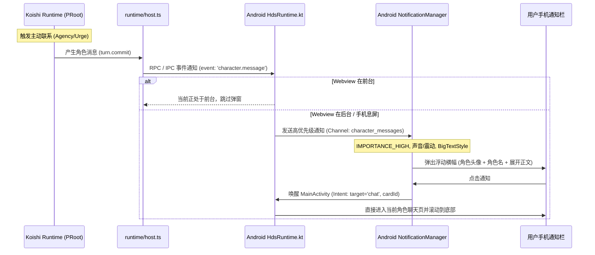

# HDS-Android 聊天体验与角色扮演体验优化 · 开源参考调研报告

> **调研目标**：基于 HDS-Android 现状（Capacitor + React 前端 + Android PRoot 原生层），对标业内优秀开源项目，为聊天流交互、消息状态沉浸感、后台高优先级系统通知、多媒体渲染、角色卡导出及主动联系配置等核心体验提供可落地的技术参考与架构设计。
> **调研原则**：代码不作任何修改；推荐项目与 GitHub 仓库链接均经真实验证。

---

## 目录

1. [精选参考项目全景对照表](#一精选参考项目全景对照表)
2. [六大专项深度调研与落地参考](#二六大专项深度调研与落地参考)
   - [Q1: 手机端 AI 聊天 / 角色扮演优秀交互与视觉实现](#q1-手机端-ai-聊天--角色扮演优秀交互与视觉实现)
   - [Q2: 消息投递状态呈现范式与自然化表达方案](#q2-消息投递状态呈现范式与自然化表达方案)
   - [Q3: 后台角色主动消息的系统通知工程实践](#q3-后台角色主动消息的系统通知工程实践)
   - [Q4: 角色表情包 / 图片 / 语音消息在聊天流中的渲染实现](#q4-角色表情包--图片--语音消息在聊天流中的渲染实现)
   - [Q5: 角色卡 / 人设导出技术方案与规范详解](#q5-角色卡--人设导出技术方案与规范详解)
   - [Q6: 角色主动消息设置界面重构与可见验证机制](#q6-角色主动消息设置界面重构与可见验证机制)
3. [落地实施优先级清单（按 ROI 排序）](#三落地实施优先级清单按-roi-排序)

---

## 一、精选参考项目全景对照表

| 项目名称 | 真实 GitHub 链接 | 语言 / 平台 | 核心定位与借鉴亮点 |
|---|---|---|---|
| **Operit** | [AAswordman/Operit](https://github.com/AAswordman/Operit) | Kotlin / Android 原生 | **后台前台服务 + 角色消息高优先级通知**（`BigTextStyle`、双通道、大头像、后台进程唤醒） |
| **RikkaHub** | [rikkahub/rikkahub](https://github.com/rikkahub/rikkahub) | Kotlin + Compose / Android | **Material You 现代聊天流**、PRoot Linux 移动端容器、分支会话、流畅软键盘避让 |
| **NativeTavern** | [miaoxworld/NativeTavern](https://github.com/miaoxworld/NativeTavern) | Dart / Flutter (iOS & Android) | **原生酒馆移动端实现**、角色立绘/差分表情切换、多模态语音条播放、滑动重抽（Swipe） |
| **LobeChat** | [lobehub/lobe-chat](https://github.com/lobehub/lobe-chat) | TypeScript / Next.js / PWA | **极致 Web 聊天输入框**、自动高度 Textarea、CJK 输入法平滑处理、折叠式思考过程（DeepSeek-R1） |
| **SillyTavern** | [SillyTavern/SillyTavern](https://github.com/SillyTavern/SillyTavern) | JavaScript / Node.js (Web) | **角色卡 V2/V3 PNG tEXt 规范与导出**、打字机状态指示器、开场白切换、表情包目录联动 |
| **Chatbox** | [Bin-Huang/chatbox](https://github.com/Bin-Huang/chatbox) | TypeScript / React / Capacitor | **跨平台极简消息状态指示器**（单/双勾已送达、重试徽标、本地 SQLite 历史同步） |
| **Character Card V3 Spec** | [kwaroran/character-card-spec-v3](https://github.com/kwaroran/character-card-spec-v3) | Specification / Markdown | **V3 与 CHARX（.charx ZIP 容器）标准规范**、内置资源 URI (`embedded://`) 规范 |

---

## 二、六大专项深度调研与落地参考

### Q1: 手机端 AI 聊天 / 角色扮演优秀交互与视觉实现

#### 1.1 项目推荐与架构分析

##### 1. [AAswordman/Operit](https://github.com/AAswordman/Operit)
- **技术栈**：Kotlin / Android 原生应用（附带 PRoot Ubuntu 容器）。
- **值得借鉴的具体点**：
  - **通知与前台服务**：在 `app/src/main/java/...` 中分离了「常驻保活服务通知」（`IMPORTANCE_LOW`）与「角色消息通知」（`IMPORTANCE_HIGH`）。
  - **触感反馈**：模型流式生成完成或角色主动发信完成时，触发系统微妙的触感振动（Haptic Feedback）。
- **对 HDS-Android 的对应效果**：直接对标解决「角色在后台主动发消息时没有系统通知、无法返回应用」的痛点。

##### 2. [rikkahub/rikkahub](https://github.com/rikkahub/rikkahub)
- **技术栈**：Kotlin + Jetpack Compose，纯 Android 原生应用。
- **值得借鉴的具体点**：
  - **输入框与软键盘避让**：使用 Android 系统的 WindowInsets 监听，输入框随软键盘平滑升降，底部工具栏（附件、模型切换、工具调用）紧凑布局。
  - **同款 PRoot 运行架构**：该项目同样在手机本地跑 PRoot Linux，但在 UI 层做了高水准的异步状态隔离，聊天界面永不因为后台容器 IO 或高负载出现掉帧卡顿。
- **对 HDS-Android 的对应效果**：优化 `apps/mobile-ui/main.tsx` 底部 composer 在软键盘弹出时偶发的遮挡或跳动问题。

##### 3. [miaoxworld/NativeTavern](https://github.com/miaoxworld/NativeTavern)
- **技术栈**：Flutter (Dart)，针对 iOS/Android 手机端重写的原生酒馆客户端。
- **值得借鉴的具体点**：
  - **气泡视觉与沉浸感**：聊天气泡自动隐藏底层机器状态，提供「左右滑动切换不同候选生成内容（Swipe）」与「轻触引用/编辑」。
  - **立绘/差分反应**：角色气泡旁或顶栏可展示情绪差分（Sprite/Expression），角色生气或开心时头像微变。
- **对 HDS-Android 的对应效果**：借鉴其极具沉浸感的气泡排版与角色身份标识，弱化系统技术参数。

##### 4. [lobehub/lobe-chat](https://github.com/lobehub/lobe-chat)
- **技术栈**：React / TypeScript / Ant Design / TailwindCSS。
- **值得借鉴的具体点**：
  - **`ChatInputArea` 输入框**（位于 `src/features/ChatInput`）：
    - 针对中文拼音输入法（IME）严格监听 `compositionstart` / `compositionend`，避免候选词未敲定时误触回车发送。
    - 自动增高高度限制（42px ~ 180px）与渐变滚动条。
    - 附件托盘采用轻盈悬浮胶囊设计，支持直接粘贴剪贴板图片。
  - **深度思考折叠气泡**：支持 DeepSeek-R1 等模型的思考过程折叠展示，附带计时器（`思考了 12 秒`），收起后保持气泡清爽。
- **对 HDS-Android 的对应效果**：直接提升 `apps/mobile-ui/main.tsx` 现有 `composer` 的输入体验与视觉层次。

---

### Q2: 消息投递状态呈现范式与自然化表达方案

#### 2.1 现状诊断
当前 `packages/contracts/index.ts` 中的文案实现：
```typescript
export function messageStatusLabel(message: Pick<Message, 'direction' | 'status'>): string {
  if (message.status === 'card-opening') return '角色卡开场白 · 本地已展示'
  if (message.direction === 'user' && message.status === 'accepted') return '核心已接收，角色尚未必回复'
  if (message.direction === 'character' && message.status === 'delivered') return '已显示'
  return message.status === 'failed' ? '发送失败' : ''
}
```
**主要问题**：
1. 「核心已接收，角色尚未必回复」和「已显示」充满后台工程调试痕迹，破坏了「正在与活生生的角色对话」的心理暗示。
2. 角色回复的气泡下方每一条都标「已显示」，在真实 IM（微信、QQ、Telegram、LINE）中完全不存在此种设计。

#### 2.2 成熟呈现范式对照（Telegram / WhatsApp / LobeChat）

| 业务底层状态 | 当前 HDS 文案 | 推荐自然表达（角色扮演 IM 范式） | 视觉呈现形式 | 业内参考实现 |
|---|---|---|---|---|
| **用户消息：发送中** | *(无，仅页面显示正在发送)* | `发送中...` | 消息气泡时间旁显示灰色微型时钟 `🕒` 或半透明 | WhatsApp / Telegram |
| **用户消息：核心已接收** (`accepted`) | `核心已接收，角色尚未必回复` | **`送达`** / **`已读`** | 优雅的小双勾 `✓✓`（或浅灰色「已读」小字，50% 透明度） | Telegram (`tg-status-read`) / LINE |
| **用户消息：发送失败** (`failed`) | `发送失败` | **`未送达 · 点击重试`** | 气泡旁红色感叹号徽标 `⚠️`，点击弹出重试浮层 | Chatbox (`MessageStatus.tsx`) |
| **角色状态：思考/生成中** | *(无，仅输入框禁用)* | **`对方正在输入...`** / **`💭 思考中 (3s)`** | 聊天流底部出现角色头像 + 3 个弹跳圆点气泡；推理模型折叠显示心路历程 | SillyTavern (`#typing_indicator`) / LobeChat |
| **角色消息：已呈现** (`delivered`) | `已显示` | **（完全留白，不显示标签）** | 仅保留右上角或右下角的时间戳（如 `18:42`），去除所有冗余字样 | 微信 / iOS iMessage / Telegram |
| **开场白** (`card-opening`) | `角色卡开场白 · 本地已展示` | **`—— 故事在此开启 ——`** | 居中细分割线或浅灰居中小字，不作为单条气泡状态标签 | SillyTavern 初始消息分隔符 |

#### 2.3 代码改造落地点
- **文件**：[packages/contracts/index.ts](file:///root/hermes-workspace/hds-android/packages/contracts/index.ts#L123-L128)
- **前端渲染**：[apps/mobile-ui/main.tsx](file:///root/hermes-workspace/hds-android/apps/mobile-ui/main.tsx#L27-L29) 的 `MessageRow` 组件：
  - 当 `message.direction === 'character'` 时，彻底隐藏 `delivered` 状态文案。
  - 当 `message.direction === 'user'` 且 `status === 'accepted'` 时，渲染微型 SVG 双勾图标或优雅的 `已读` 标记。
  - 在 messages 列表末尾，当 `sending === true` 时插入 `<TypingIndicator characterName={active?.card.name} />`。

---

### Q3: 后台角色主动消息的系统通知工程实践

#### 3.1 现状与差距
- 当前 [HdsService.kt](file:///root/hermes-workspace/hds-android/android/app/src/main/java/io/hdsinterlude/android/HdsService.kt#L43-L54) 只有一个通道 `hds-runtime`，优先级为 `NotificationManager.IMPORTANCE_LOW`，通知为常驻 `setOngoing(true)`。
- 当 PRoot 中的 Koishi 运行时触发 `agency` 或 `urge`（主动联系/弹性推进）并在后台向数据库写入角色消息时，**Android 系统层完全没有向系统 NotificationManager 发送消息通知**。用户把手机揣在兜里根本不知道角色发来了消息。

#### 3.2 业界最佳实践架构（Operit AI 模型）



#### 3.3 原生 Android 关键实现要素（Kotlin 代码方案）

1. **双通道设计 (Notification Channels)**：
   - 通道 A：`hds_service_channel`（`IMPORTANCE_MIN` 或 `LOW`）——专门给前台服务保活用，常驻且静音。
   - 通道 B：`character_message_channel`（`IMPORTANCE_HIGH`）——专门用于角色主动发消息，允许响铃、震动与横幅弹窗。
2. **富文本样式 (`NotificationCompat.BigTextStyle`)**：
   ```kotlin
   val intent = Intent(context, MainActivity::class.java).apply {
       action = Intent.ACTION_VIEW
       putExtra("target_page", "chat")
       putExtra("card_id", cardId)
       flags = Intent.FLAG_ACTIVITY_NEW_TASK or Intent.FLAG_ACTIVITY_CLEAR_TOP
   }
   val pendingIntent = PendingIntent.getActivity(
       context, 
       messageId.hashCode(), 
       intent, 
       PendingIntent.FLAG_UPDATE_CURRENT or PendingIntent.FLAG_IMMUTABLE
   )

   val notification = NotificationCompat.Builder(context, "character_message_channel")
       .setSmallIcon(R.drawable.ic_notification_chat)
       .setLargeIcon(characterAvatarBitmap) // 角色圆形头像
       .setContentTitle(characterName)       // 标题直接显示角色姓名
       .setContentText(content)              // 首行内容预览
       .setStyle(NotificationCompat.BigTextStyle().bigText(content)) // 下拉可查看完整长文
       .setPriority(NotificationCompat.PRIORITY_HIGH)
       .setCategory(NotificationCompat.CATEGORY_MESSAGE)
       .setContentIntent(pendingIntent)
       .setAutoCancel(true)
       .setDefaults(NotificationCompat.DEFAULT_ALL)
       .build()

   notificationManager.notify(cardId.hashCode(), notification)
   ```
3. **免打扰（Quiet Hours）控制**：
   - 在原生层或前端 settings 增加「免打扰时段」（默认 23:00 ~ 08:00）。
   - 在发送通知前做时间判断：若落在免打扰区间内，将通道或通知优先级降为 `IMPORTANCE_LOW`，不产生铃声或震动，静默收纳在通知栏。

---

### Q4: 角色表情包 / 图片 / 语音消息在聊天流中的渲染实现

#### 4.1 图片气泡（Image Bubbles）
- **现状**：HDS-Android 使用 [StoredImage.tsx](file:///root/hermes-workspace/hds-android/apps/mobile-ui/StoredImage.tsx) 从桥接通过 RPC 读取图片的 `dataUri` 并渲染为单张 ``。
- **痛点**：图片加载前无宽高占位导致页面跳动（CLS）；图片点击无法全屏放大查看或长按保存。
- **参考实现**：
  - **LobeChat**：使用 CSS `aspect-ratio` 预先占位，使用毛玻璃背景骨架屏，集成全屏预览灯箱（Pinch-to-zoom、手势拖拽关闭、双击缩放）。
  - **建议落地**：在前端引入轻量级 Modal 灯箱，点击气泡中的图片放大全屏，并提供「保存到系统相册」的桥接调用。

#### 4.2 表情包 / 贴纸渲染（Stickers）
- **现状发现**：在代码库调研中发现，`upstream/hds-interlude` 源码内**已经存在**完整的本地表情包库逻辑（`stickers: true`，存放在 `data/hds-interlude/stickers`）。
- **交互与渲染参考**：
  - **Telegram / 微信贴纸规范**：表情包/贴纸消息**不包含常规气泡背景（无灰色/彩色气泡边框）**，直接以透明底 PNG/GIF 形式渲染在聊天流中，尺寸限定在 120dp ~ 160dp 之间。
  - **贴纸面板**：在输入框 `＋` 菜单或表情图标中，增加贴纸面板抽屉，点击直接发送表情包，角色端也可以从其表情库中选取匹配情绪的贴纸发出。

#### 4.3 语音条与音频播放（Voice Bars）
- **参考实现**：[AstrBot-Bubble-Android-App](https://github.com/MuFengDR/AstrBot-Bubble-Android-App) 与 [miaoxworld/NativeTavern](https://github.com/miaoxworld/NativeTavern)。
- **视觉设计**：
  - 胶囊型语音气泡：`[ ▶ 播放按钮 ] [ ılılılıl 声波振幅动画 ] [ 0:18 时长 ] [ 1.0x/1.5x 倍速 ]`。
- **底层转码机制**：
  - QQ 语音通常为 Tencent Silk 编码（`.amr` / `.silk`）。前端可通过 WebAssembly 库（如 `silk-wasm`）在浏览器线程直接将其转码为标准 AudioContext PCM / WAV 播放，无需依赖手机原生 MediaPlayer，保持前端纯粹。

---

### Q5: 角色卡 / 人设导出技术方案与规范详解

#### 5.1 各大角色卡格式规范对比

| 角色卡格式 | 载体格式 | 规范维护方 / 来源 | 数据结构与元数据存储机制 | 优缺点分析 |
|---|---|---|---|---|
| **SillyTavern Card V2** | PNG 图像 | [spec_v2.md](https://github.com/malfoyslastname/character-card-spec-v2) | PNG `tEXt` 块，Key 为 `chara`，Value 为 Base64 编码的 V2 JSON（包含 `spec: "chara_card_v2"`, `data: {...}`） | **生态最广泛**，各大酒馆平台（Chub, Jan, Risu）100% 兼容；单图即角色 |
| **SillyTavern Card V3** | PNG 图像 | [SPEC_V3.md](https://github.com/kwaroran/character-card-spec-v3) | PNG `tEXt` 块，Key 为 `ccv3`，Value 为 Base64 编码的 V3 JSON（支持多立绘、群组设定、资产映射） | V2 超集，扩展性强；部分老工具可能只读 `chara` 块 |
| **CHARX (`.charx`)** | ZIP 压缩包 | [kwaroran / SPEC_V3](https://github.com/kwaroran/character-card-spec-v3) | 标准 ZIP 压缩包改后缀名。根目录下必须有 `card.json`（V3 规范），`assets/` 存放多表情包、立绘、音频，卡内通过 `embedded://assets/...` 引用 | **未来多模态标准**；打包体积自包含，但移动端解压打包需引入 zip 库 |
| **JSON 角色卡** | 纯文本 `.json` | 通用标准 | 裸 JSON 文件，通常为 V2/V3 根对象结构 | 最简单透明，不依赖图像载体；但无角色封面图 |
| **typ0 角色码 / YAML** | 文本 / 8位码 | [typ0.space](https://typ0.space) / HDS | 8 位短码向 typ0.space 云端同步，或本地 `koishi.yml`（包含 `storyDefaults` 对象） | HDS 原生人设格式，包含世界、地点、叙事视角等独家字段；外部通用酒馆不直接识别 |

#### 5.2 PNG tEXt 块导出写入算法（零三方库纯 TypeScript 实现）

当前 HDS-Android 在 [packages/card-format/index.ts](file:///root/hermes-workspace/hds-android/packages/card-format/index.ts#L62-L66) 中**已经内置了标准 CRC32 校验函数**，可以直接复用，实现零外部依赖的 PNG 卡导出：

```typescript
// 纯 TypeScript 实现向 PNG 写入 V2/V3 chara tEXt 块
export function exportCardToPng(avatarPngBytes: Uint8Array, card: Card): Uint8Array {
  // 1. 构建符合 Tavern V2 的 JSON 结构
  const v2Payload = {
    spec: 'chara_card_v2',
    spec_version: '2.0',
    data: {
      name: card.name,
      description: card.description,
      personality: card.personality,
      scenario: card.scenario,
      first_mes: card.firstMessage,
      mes_example: card.examples,
      creator_notes: card.creatorNotes,
      system_prompt: card.systemPrompt,
      post_history_instructions: card.postHistoryInstructions,
      alternate_greetings: card.alternateGreetings,
      character_book: card.lorebook,
      extensions: card.raw?.extensions || {}
    }
  }

  // 2. Base64 编码
  const jsonText = JSON.stringify(v2Payload)
  const base64Data = btoa(unescape(encodeURIComponent(jsonText)))

  // 3. 构建 tEXt 块：keyword ('chara') + 0x00 + base64String
  const keyword = new TextEncoder().encode('chara')
  const content = new TextEncoder().encode(base64Data)
  const chunkData = new Uint8Array(keyword.length + 1 + content.length)
  chunkData.set(keyword, 0)
  chunkData[keyword.length] = 0 // null 分隔符
  chunkData.set(content, keyword.length + 1)

  // 4. 构建 PNG 块：Length (4B) + Type 'tEXt' (4B) + Data + CRC32 (4B)
  const chunkLength = chunkData.length
  const chunkType = new TextEncoder().encode('tEXt')
  const crcInput = new Uint8Array(4 + chunkLength)
  crcInput.set(chunkType, 0)
  crcInput.set(chunkData, 4)
  const chunkCrc = crc32(crcInput) // 复用现有 packages/card-format/index.ts 的 crc32

  const fullChunk = new Uint8Array(4 + 4 + chunkLength + 4)
  new DataView(fullChunk.buffer).setUint32(0, chunkLength, false)
  fullChunk.set(chunkType, 4)
  fullChunk.set(chunkData, 8)
  new DataView(fullChunk.buffer).setUint32(8 + chunkLength, chunkCrc, false)

  // 5. 插入 PNG 中：放置在 IHDR 块之后 (offset: 33)
  // PNG Header (8 bytes) + IHDR (12 bytes + 13 bytes data = 25 bytes) = 33 bytes
  const output = new Uint8Array(avatarPngBytes.length + fullChunk.length)
  output.set(avatarPngBytes.subarray(0, 33), 0)
  output.set(fullChunk, 33)
  output.set(avatarPngBytes.subarray(33), 33 + fullChunk.length)

  return output
}
```

---

### Q6: 角色主动消息设置界面重构与可见验证机制

#### 6.1 现状痛点
1. **设置入口割裂**：
   - 总开关 `autoAdvance`（持续生活与主动联系）在 `main.tsx` 的「故事与身份」折叠卡片中；
   - 参数配置却被淹没在 `LifeSettings.tsx` 的 `schema.sections` 动态表单中，充满「弹性推进」、「主动联系」、「时间导演」等抽象概念。
2. **缺乏状态透视与验证反馈**：
   - 用户打开开关后，不知道当前角色是否打算发消息、不知道什么时候会发、更不知道后台保活和通知到底通不通。

#### 6.2 优秀界面重构方案（「角色日常来信」卡片）

建议将复杂的参数折叠，在界面层抽象为三个层级：

```
┌────────────────────────────────────────────────────────┐
│ 💌 角色日常来信与主动关怀                                │
│ 让角色在离开应用时，也能按照自己的生活作息主动找你说话。     │
├────────────────────────────────────────────────────────┤
│ [ 主动来信总开关 ]                                 [ 开 ]│
│                                                        │
│ 互动节奏：                                              │
│ ( ) 偶尔关怀 (每天1-2次，闲暇时简短问候)                 │
│ (●) 贴近日常 (每3-4小时，依生活剧本自然触发) [推荐]      │
│ ( ) 频繁热络 (有感触即发，API消耗较高)                   │
│                                                        │
│ 🌙 夜间免打扰： [ 23:00 ] 至 [ 08:00 ] (夜间不响铃打扰)  │
├────────────────────────────────────────────────────────┤
│ 🔍 状态透视：                                           │
│ • 当前状态：空闲中（在自习室看书）                       │
│ • 预期联系：预计今晚 21:15 前后                         │
│ • 今日后台消耗：3 / 120 次                             │
├────────────────────────────────────────────────────────┤
│ [ ⚡ 立即测试一次角色来信 ]                             │
│ 点击后锁屏或切到后台，5秒后角色将发送一条测试通知以验证。  │
└────────────────────────────────────────────────────────┘
```

#### 6.3 「立即测试 / 触发验证」闭环设计

为彻底消除用户的「到底能不能发」疑虑，设计一个**确定性的端到端测试流程**：
1. 用户在设置界面点击 **「立即测试一次角色来信」**。
2. 界面弹出友好提示：*「测试指令已发出，请在倒计时 5 秒内将应用退至后台或锁屏...」*，并展示 5 秒倒计时。
3. 前端调用 RPC `story.testProactiveContact`（或模拟一条即时 intent）。
4. 倒计时结束后，由后台服务产生一条真实回复，并直接调用高优先级系统通知渠道。
5. 手机震动/发声，通知栏弹出带有角色头像和台词的通知（如：*“在忙吗？刚刚看到窗外的云很好看，突然想跟你说一声。”*）。
6. 用户点击该通知，直接打开应用并跳转回聊天流。这一闭环能 100% 验证「手机省电策略、PRoot 后台运行、通知通道、跳转意图」全链路完好。

---

## 三、落地实施优先级清单（按 ROI 排序）

根据**改动成本**与**用户体验提升幅度（沉浸感/实用性）**，建议按以下三期迭代推进：

| 优先级 | 优化项目 | 涉及层面 | 改动范围与关键文件 | 预期投入 | 产出收益与体验跃升 |
|:---:|---|:---:|---|:---:|---|
| **P0** | **消息状态标签沉浸化重构** | **纯前端** | `packages/contracts/index.ts` (`messageStatusLabel`)<br>`apps/mobile-ui/main.tsx` (`MessageRow`) | **0.5 天** | **极高**。彻底清除「核心已接收」「已显示」等出戏机器词汇，换为已读小双勾与自然时间戳，立竿见影。 |
| **P0** | **后台角色消息高优先级系统通知** | **原生 + 运行时** | `android/.../HdsService.kt`<br>`android/.../HdsRuntimePlugin.kt`<br>`runtime/host.ts` | **1.5 天** | **极高**。实现 Operit 同款的后台高优先级通知（BigTextStyle 展开、大头像、点击返回聊天），让角色主动发信真正触达用户。 |
| **P1** | **主动联系设置整合与「立即测试」验证** | **纯前端 + 少量RPC** | `apps/mobile-ui/LifeSettings.tsx`<br>`apps/mobile-ui/main.tsx`<br>`runtime/host.ts` | **1 天** | **高**。将分散晦涩的 agency/urge/autoAdvance 收敛为单一直观的「日常来信」卡片，并提供 5 秒锁屏测试通知按钮。 |
| **P1** | **角色卡/人设导出（PNG tEXt 与 JSON）** | **纯前端** | `packages/card-format/index.ts`<br>`apps/mobile-ui/CardEditor.tsx`<br>`apps/mobile-ui/main.tsx` | **1 天** | **高**。补齐角色卡双向流转（导入/导出），利用现有 `crc32` 直接生成兼容 SillyTavern 的 PNG 卡与 JSON，支持分享保存。 |
| **P2** | **输入框与思考状态流式优化** | **纯前端** | `apps/mobile-ui/main.tsx` (`composer`)<br>`apps/mobile-ui/style.css` | **0.5 天** | **中高**。增加角色正在输入的三点弹跳动画；为 DeepSeek 思考模型增加优雅的折叠思考过程气泡。 |
| **P2** | **图片气泡灯箱与表情包无底框渲染** | **纯前端** | `apps/mobile-ui/StoredImage.tsx`<br>`apps/mobile-ui/style.css` | **0.5 天** | **中**。图片支持轻触全屏缩放手势；角色发送的贴纸移除厚重气泡边框，贴近真实 IM 贴纸效果。 |
| **P3** | **语音消息气泡与 Silk 音频转码** | **前端 + WASM** | `apps/mobile-ui/VoiceBubble.tsx`<br>`runtime/media.ts` | **3~4 天** | **中**。引入 wasm 转码实现 QQ Silk/AMR 语音条播放，视觉上补齐语音胶囊条。 |

---

## 四、调研结论与执行建议

1. **改动重心明确**：
   - 用户最关心的**出戏状态词（P0）**、**主动联系设置复杂（P1）**以及**角色卡导出（P1）**均在 `apps/mobile-ui/` 与 `packages/` 内部，**属于纯前端改动**，风险极低、生效迅速且无需编译 Android 原生 Native 产物。
   - 用户看中的 **Operit 系统通知特性（P0）** 需要在 `HdsService.kt` 中新建一个高优先级的 `NotificationChannel`，并在 `host.ts` 的消息提交点挂接原生桥接广播，这是唯一需要动原生 Kotlin 层的模块，但模式非常标准稳定。
2. **保持技术纯粹性**：
   - 角色卡导出完全不需要引入繁重的 Native 图片处理库，利用现有的 `crc32` 算法直接操作 Uint8Array 即可在 Web 线程完成 PNG tEXt 块拼接。
3. **沉浸式原则**：
   - 角色扮演应用的核心魅力在于「模糊现实与虚拟的边界」。聊天界面应全面隐藏后台调度引擎的生硬技术术语，让每一次等待变成「对方正在输入...」，让每一次后台收到消息都如同真实好友的来信。
